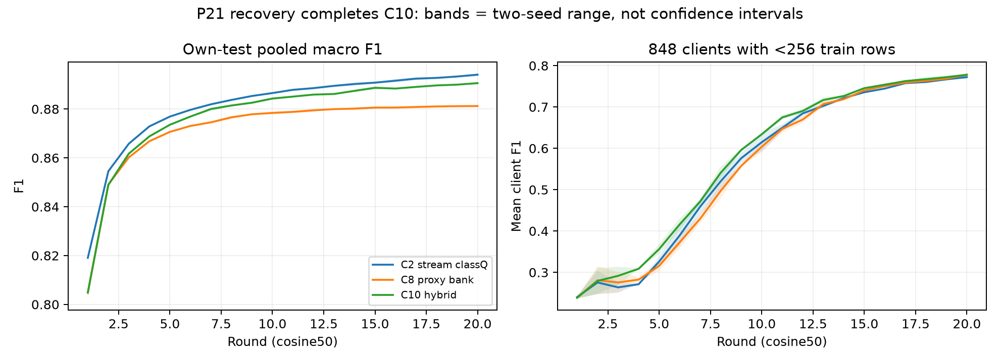

# P21 recovery — C10 hybrid đã đủ hai seed, 02/11/2026

**Hybrid hơn proxy thuần và inputensemble cùng bank về pooled F1, nhưng vẫn dưới streamingclassQ.**
Xe<256mẫu chưa hơn proxy/ensemble nhất quán. Chưa chọn hybrid làm phương pháp chính hoặc tăng lực KD cho mọi xe.

Đây là bổ sung cho [phân tích P20 ngày01/11](../../../docs/research/results-p20.md), không ghi đè artifact, closure hoặc báo cáo cũ.
OriginalP21 vẫn FAIL trước r1; `accanniez/mh-p21-hybrid-s43-recovery1/1` là P21R1/logicalP21/C10seed43,
fresh r1–20, không resume. Kết hợp31run cũ với recovery: đủ32logicalarm/16cell×2seed tại endpoint20.

## Audit và phạm vi

Job `kaggle-p21-recovery20-20261101` succeeded03:35:00+07, marker đúng. Đã kiểm lại artifact thực:

- BaseSHA/9overlay/source46file khớp;8overlay scientific cũ không đổi, thêm guardentrypoint.
  Toàn bộ HP bằng originalP21:5343xe/77input/16lớp/DAGSNetW1/395408parameter/seed43,
  train+val/batch64/1epoch/resetAdamW/AMPfp16/cosine50, endpoint20 đã khóa.
- Hai TeslaT4 compilegatePASS. Mỗi rank có20record finite,42group/r,2672/2671xe; skippedfraction0 cả20round.
- 20own-testCM đủ9347679row/round,6trainCM đủ37361273row; đối chiếu metric/source/config/LR,
  teacherlag/aggregate/codec/replica và diagnostics bằng auditor P20; report tái kiểm khớp report worker.
- 20snapshot `weights_only=True`, hữu hạn; dựng lại proxyDAGSNet với parameters và BN, `strict=True` đủ20snapshot.
  Không fullprivatecheckpoint/rebuild mọi modelxe, prediction→CM replay hoặc fullcontentfingerprint dataset.
- Guard và recovery thành công **chưa xác định hoặc sửa được nguyên nhân NaN gốc**.
  [Hồ sơ sự cố/probe](p20-numerical-incident.md) giữ nguyên bằng chứng failedrun.

Receipt: `runs/p-study/analysis-p21-recovery/verification.json` khóa SHA artifact/report/source.
KaggleCOMPLETE/exit0 riêng lẻ không được dùng thay các cổng trên. [Đủ10metric mỗi round](metrics-p21-recovery.md).

## Endpoint20 và các đối chứng

F1 dạng0–1, mỗi model chấm tương lai của chính xe; pooled gộp toàn bộ own-test. Hai seed là42/43;
C10seed43 dùng recovery mới, các số khác từ31run đã khóa.

| cell | pooled F1 s42/s43 | mean F1 xe<256 s42/s43 | p10 F1 mọi xe s42/s43 | tổng MB/xe/20r |
|---|---|---|---|---:|
| C2 streamingclassQ | .893495/.894642 | .767830/.776761 | .695214/.698411 | 3.333504 |
| C7 bankinputensemble | .881688/.881862 | .776180/.780570 | .684860/.694533 | 4.623744 |
| C8 proxybank | .880840/.881622 | .774552/.781504 | .686271/.689725 | 4.623744 |
| C10 proxyhybrid | .891047/.890161 | .775380/.780472 | .697916/.703754 | 4.623744 |

| C10 trừ đối chứng | delta pooled s42/s43 | delta mean xe<256 s42/s43 | xe giảm F1 s42/s43 |
|---|---|---|---|
| C8 proxythuần | +.010208/+.008540 | +.000827/−.001033 | 1833/1926 |
| C7 inputensemble | +.009359/+.008299 | −.000800/−.000099 | 1949/1997 |
| C2 streamingclassQ | −.002447/−.004481 | +.007549/+.003710 | 2600/2733 |
| C1 streamingaugmentation | −.000505/−.002844 | +.008452/+.005774 | 2365/2513 |

So C2,1412xe giảm ở cảhai seed, trong đó149xe<256mẫu. So C8 vẫn883xe giảm cảhai seed.
Số xe giảm đọc cùng support và độ lớn delta; đây không significance hoặc selector chọn method theo test từngxe.
Trên1555absenttestrow của xe nhỏ, C10 accuracy=.527331/.538264, vẫn dưới C2=.533119/.543408;
mean/p10 tốt hơn không tự bảo toàn lớp chưa thấy.

Band=min–max hai seed, không confidenceinterval. Hybrid còn tăng r15→20:
pooled+.002984/+.000832, meanxe<256+.030445/+.034239. Chưa có plateau đồng loạt.

## Server đã cải thiện gì, chưa giải quyết gì

C10 giữ bank/uplink/outputdownlink như C8, đổi target fitproxy thành .5ensemble + .5onehot của nhãn synthetic
(công thức đã khóa tại [thiết kế P20](screening-p20.md)). Gain pooled lặp lại hai seed cho thấy chỉ ép proxy
bắt chước ensemble trên synthetic chưa tận dụng tốt thông tin nhãn sinh được trong setting này.
Đây là live total effect gồm teacherfeedback, không phân rã causal riêng bước serverfit.

Gain C10−C8 tập trung ở suddenConstantSpeedF1 +.088885/+.069419 và timeDelayF1 +.030529/+.031005;
benignF1 lại −.012785/−.010502. Không gọi đây là nâng đều các lớp hoặc nhãn synthetic luôn đúng.

Teacherproxy trên cùng9721realtestrow/34xe diagnostic:

| cell/seed | teacher F1 | student F1 | teacher đúng/student sai | student đúng/teacher sai |
|---|---:|---:|---:|---:|
| C8/42 | .790386 | .856093 | 251 | 476 |
| C8/43 | .798265 | .855271 | 286 | 447 |
| C10/42 | .819866 | .858020 | 342 | 1062 |
| C10/43 | .806116 | .864816 | 304 | 1072 |

Teacher macroF1 tăng so C8, vẫn thấp hơn student tương ứng. Teacherđúng/studentsai là cơ hội và chiều ngược là rủi ro
tại cùnginput; không phải số lỗi KD đã sửa/gây ra. C10 chỉ distill trên synthetic, bảng34xe evaluator-only,
không đại diện toàn mạng hoặc kênh validation cho server. Tăng teacherconfidence/KDweight chưa có căn cứ.

Vì C10 cải thiện nhiều so C8 mà vẫn dưới C2, **teacherresolution, mục tiêu serverfit và support đều còn cần tách**.
Không suy teacher là bottleneck duy nhất, hoặc đổi kiến trúc client/tăng modelserver sẽ giải quyết được.

## Chi phí recovery và bước tiếp

| P21R1, mỗi xe | byte |
|---|---:|
| bootstrap upload | 1655872 |
| bootstrap download | 1655872 |
| upload20round | 656000 |
| download20round | 656000 |
| tổng | 4623744 |

32800B/chiều/round, tổng gồm bootstrap cao hơn C2 khoảng38.7%. Payload protocol, chưa transport/ACK/crypto/contactproof.
Thời gian mô phỏng toàn5343xe/2T4: train12579.13s, eval591.63s, diagnostics652.90s,
notebooklog15428.75s≈4.286h; chưa phân bổ1605.09s gồm setup/compile/I/O/finalization và lệch mốc.
Server231.94s và scoringlocalrank0 404.33s đã nằm trong train, không cộng lần hai; không latency một xe.
Quota GPU-hour thực không có measurement riêng; walltime không thay phép đo đó.

Q20 đã khóa trước kết quả recovery này: kiểm riêng mixedsupport→inputtarget→inputweight→clientreception,
giữ streamingclassQ làm nền và downlinkoutput thay modelweights. Không sửa QHP/source hoặc chạy thêm teacher vì đã đọc test.
Hybrid server có tín hiệu đáng giữ để chẩn đoán sau Q, chưa thay directensemble/control mặc định.
Validation train-only sạch cần có trước qualityweight hoặc quyết định kéo xe yếu theo teacher nhiều hơn;
replay cùngtrajectory còn cần để tách feedback khỏi support. [Đề xuất đang có](proposed-method-p20.md).

Hai seed/20round, officialtest đã đọc nhiều batch: exploratory, không freshconfirmatorytest hoặc proof50round.
Benign/timeDelay featureoverlap, worldcontextshortcut và Sybilprior8.80%train→17.67%test vẫn là caveat
([dataset](../../../knowledge/dataset.md)); chưa tách overfit khỏi temporalshift bằng validation độc lập.
Không rawlocalrows/features/per-rowlabels/privateweights trong FLmessages; chưa formalDP/secureaggregation hoặc mixedarchitectureproof.
Reference gắn đúng thành phần C8/C10 tại [method](../../../docs/research/method.md): adaptationserverdistillation, hybridhardlabel là giả thuyết riêng.

Tái tạo: `python scripts/analyse_p21_recovery.py` trong envnckh; giữ nguyên báo cáo/source P20 gốc và failureP21.
Fullprecision: `runs/p-study/analysis-p21-recovery/{analysis.json,metrics-all-rounds.csv,verification.json}`.
