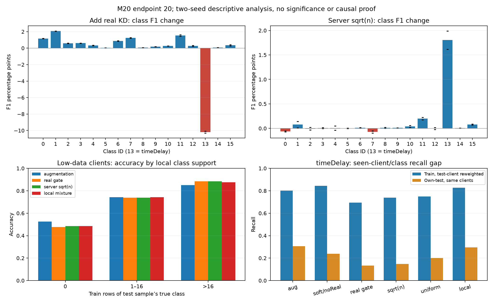

# M20 — phân tích cơ chế sau audit, 01/11/2026

**Vấn đề gồm tổng quát hóa theo thời gian, đánh đổi giữa các lớp và cách client tiếp nhận Q; chưa có bằng chứng rằng chỉ cần teacher mạnh hơn hoặc thêm round.**
Nguồn: CM/probe/Q của16run đã audit, [kết quả/10metric](results-m20.md). Đây là phân tích hậu nghiệm; không chọn HP/best round theo test, không thay protocol.
Tái tạo: `python scripts/diagnose_m20.py`; JSON/figure tại `runs/diagnosis-m20/`. Input fingerprint gồm3manifest evidence + batch/Q/count/support. Không sửa artifact DVC đang push.

## 1. Điểm tổng che đánh đổi giữa các lớp

| can thiệp | seed | Δmacro-F1 | ΔF1 timeDelay | mean ΔF1 của15lớp còn lại |
|---|---:|---:|---:|---:|
|thêm realKD|42|-0.000046|-0.100653|+0.006661|
|thêm realKD|43|-0.000582|-0.103017|+0.006247|
|server sqrt(n)|42|+0.001482|+0.019892|+0.000255|
|server sqrt(n)|43|+0.001158|+0.016168|+0.000158|
|uniform mixture|42|+0.001568|+0.060365|-0.002352|
|uniform mixture|43|+0.001123|+0.055439|-0.002498|
|local so uniform|42|-0.000692|+0.058635|-0.004647|
|local so uniform|43|+0.000429|+0.065311|-0.003896|

Riêng timeDelay đóng góp 83.9%/87.2% gainmacro của server sqrt(n). Đây là phân rã số học, không chứng minh cơ chế server chỉ tác động lớp13.
Uniform/local mixture cứu timeDelay nhưng giảm trung bình15lớp còn lại. Không gọi đó là teacher tốt hơn toàn diện hoặc mọi xe được lợi.

## 2. Chênh train–test tồn tại cả ở xe nhiều mẫu

Đối chiếu **cùng xe, cùng lớp đã có train**, cân recall train theo support test của từng xe: `sum_k(test_count[k,c] * train_TP[k,c]/train_count[k,c]) / sum_k(test_count[k,c])`. Loại ô absent-train khỏi cảhai vế. Cách này giảm nhiễu do thay trọng số xe giữa train/test; train vẫn là in-sample, chưa tách overfit khỏi temporal/feature shift.

| cấu hình | recall train đã cân, timeDelay seed42/43 | recall own-test cùng ô seed42/43 |
|---|---|---|
|augmentation|0.8024/0.8028|0.3068/0.3071|
|softQ/noReal|0.8431/0.8432|0.2391/0.2383|
|softQ/realgate|0.6943/0.6942|0.1347/0.1324|
|local mixture|0.8258/0.8301|0.2961/0.2966|

Với realgate, xe≥4096mẫu vẫn khoảng.6766/.6758 train so.1363/.1342 test; xe<256 chỉ.0504/.0381 test trên2102dòng timeDelay đã có lớp trong train. Vì vậy thiếu lớp/ít bước không giải thích hết vấn đề.
Global prior timeDelay gần giữ nguyên không có nghĩa prior từng xe giữ nguyên. TVD giữa vector prior train/test có median.222 toàn mạng, .306 ở xe<256. Chưa quy gap thành label shift alone: còn optimism của train và thay đổi đặc trưng theo thời gian.

## 3. Xe ít dữ liệu chưa được kéo lên đồng đều

848xe<256mẫu có median40testrows. SoftQ/realgate hơn noReal ở meanF1 nhóm nhỏ nhưng chỉ38,8%/38,7% xe tăng; 28,4%/29,1% xe giảm hơn.01F1. Hai seed cùng tăng ở147/848xe; cùng giảm>.01 ở96/848xe. Đây là mô tả paired, không kiểm định độc lập: các xe dùng chung teacher và cùng tập test.
Realgate tăng p10 so augmentation, nhưng std giữa xe không giảm nhất quán qua hai seed (.1100/.1085 so .1105/.1076). Chưa đạt kết luận chất lượng xe đồng đều hơn một cách ổn định.
Giữa seed42/43 của cùng realgate, median |ΔF1/xe nhỏ|≈.039; không dùng chênh này làm CI/noisebound cho gain phương pháp.

| support local của lớp test, xe<256 | augmentation acc42/43 | realgate acc42/43 |
|---|---|---|
|0|0.5267/0.5235|0.4778/0.4778|
|1–16|0.7393/0.7481|0.7340/0.7439|
|>16|0.8456/0.8548|0.8815/0.8858|

Absent/rare/seen có1555/9776/23496testrows. Gain tập trung lớp đã có>16mẫu; lớp absent chưa tốt lên. Riêng timeDelay absent có101dòng, realgate đúng0/101 ở cảhai seed; support nhỏ, không kết luận cho toàn bộ xe/lớp absent.

## 4. Round chưa phản ánh lượng tối ưu của từng xe

Xe<256 có2–4bước/round, median3; xe≥4096 có median212. Sau20round tương ứng median60so4240bước. Mỗi bước sinh64row cân16lớp, nên số synthetic/lớp/xe có median240so16960 sau20round. Đây là số lượt sinh, không phải số mẫu độc lập có chất lượng.
Loss real/synthetic lấy mean riêng, nên tăng số mẫu không tự giảm hệ số synthetic. Optimizer AdamW reset mỗi round theo protocol; không âm thầm giữ moment hoặc thêm epoch riêng cho một đối chứng.
**Giả thuyết mới cần kiểm:** forward real+synthetic chung BN; batch cuối xe nhỏ có median2/3row synthetic. Với momentum.1, batch cuối chiếm median36,9% trọng số các moment mới của epoch ở xe nhỏ. Đây là tính toán từ lịch batch, chưa đo BN activation, chưa chứng minh nguyên nhân giảm F1. Không mở lại BNsplit v1 chỉ từ tên kỹ thuật; cần probe hiện tại trên clone, không đổi weights hoặc dùng test để fit BN.

## 5. Q đang truyền nội dung gì?

Ở realgate seed42, Q19[13,13]≈.5411;94,5% khối lượng offdiagonal lớp13 dồn vào benign. Q cùng lớp giống nhau cho mọi input, nên server truyền trung bình hành vi theo lớp; không bổ sung phân biệt giữa hai input cùng lớp. Phần hình học input đến từ local data và synthetic generator. Q đúng argmax không đồng nghĩa từng mẫu nhận hướng cập nhật tốt.
Với KL(Q||p), gradient logit là `p−Q` khi Q chuẩn hóa; sau clamp của code, dạng chính xác là `(sum Q_clamped) p−Q_clamped`. Nếu student đã có p_y>Q_yy thì KD kéo xác suất đúng xuống; có thể là regularization hữu ích hoặc cản mẫu đã học. RealCE hiện dùng logit adjustment nên không đồng nhất gradientCE thành `p−onehot` trên rawlogit.
Probe34xe tại r20:75,6%/76,5% row được realgate giữ có logit-gradient KD ngược CE; ở parameter-gradient tổng theo xe chỉ20,6%/29,4% cosine âm. Không lấy logitcosine âm làm chứng minh KD hại: realKD vẫn nâng15lớp khác. Probe là fp32/dropout0/trainBN sau epoch, không replay bướcAMP thực.

| lớp | effective contributors n / sqrt(n) | khối lượng xe<256 n / sqrt(n) |
|---|---|---|
|0|962.8/2717.3|0.397%/3.443%|
|13|877.1/2347.8|0.335%/2.300%|

`effective contributors=1/sum(w_kc²)`, không phải số xe tham gia. sqrt(n) tăng đại diện xe nhỏ nhưng chưa tăng utility của xe nhỏ nhất quán. Confidence/accuracy trên chính train chưa đo được chất lượng teacher trên tương lai; không dùng mỗi count hoặc trainconfidence làm độ tin cậy đã được chứng minh.

## Kết luận cho bước tiếp

Giữ ba câu hỏi riêng: thông tin Q có ích gì; khâu tiếp nhận có làm méo local learning; model có tổng quát sang tương lai không. Ưu tiên [đối chứng tiếp](diagnostic-next.md). Không có bảo đảm F1 tăng từng round; cần slope/cohort/độ ổn định thay cho lời hứa đơn điệu.
Các kết luận trên chỉ16run/2seed/r≤20, chung DAGSNet. Không formalprivacy/mixedarchitecture/contactdrop proof. Bootstrap vẫn99,35% tổng byte20round; sửa gate/loss trước có thể giữ nguyên packet1088B/xe/round.
