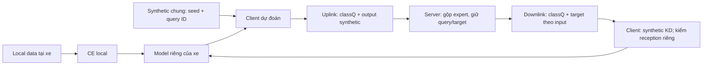

# Hướng phương pháp sau P20 — nâng xe yếu, giữ khả năng của xe mạnh

Trạng thái: **đề xuất để kiểm chứng**, chưa là phương pháp tối ưu hoặc kết quả mới.
Nguồn: [31run đã audit](results-p20.md), [transfer từng xe](p20-client-transfer.md),
[O20 replay](results-o20.md), [M/N/O/P lessons](../../LESSONS.md).
[P21/C10seed43](results-p21-recovery.md) đã audit/phân tích20round; hybrid hơn proxythuần pooled hai seed,
vẫn dưới streamingclassQ, xe nhỏ chưa hơn ensemble nhất quán. Chưa thay hướng chính bằng proxy.
[Q20](results-q20.md) đã audit/phân tích16run: S0/querycontrol/S1/S2,
inputensemble√n và realKD/margin/strength. Inputtargets nâng weakcohort, margin tăng pooled/mean/p10 nhưng hại absent/timeDelay;
sqrtinputweight chưa giúp. Không xem negativecount như causalharm khi querycontrol cũng đổi percar;
repeatedcontrol/receptionreplay và validation sạch là cổng tiếp.
validationreliability, querymemory và gradientprojection vẫn là proposal, không gọi đã chạy.

## Kết luận về nguyên nhân và cấu trúc model

Chưa có lý do thực nghiệm để đổi kiến trúc client. Giữ DAGSNetW1/395408parameter/77input như benchmark.
Ba khâu cần sửa cùng nhau: thông tin upload → server gộp/giữ tri thức → client học từ local và teacher.
Distillation không giải thích mọi lỗi: local-only vẫn có gap train/test lớn, cả xe nhiều mẫu.

| bằng chứng | suy luận có căn cứ | điều chưa được chứng minh |
|---|---|---|
| Augmentation thêm~.033–.034pooledF1, giúp absentrows xe nhỏ | synthetic từ thống kê toàn mạng đã mang tri thức thiếu ở local | generator hiện đã đủ coverage hoặc jointmanifold đúng |
| C7 hơn C6 cùngbank ở pooled/low256/p10 cảhai seed | classmean làm mất thông tin hữu ích theo input | inputbank hơn streamingclassQ, hoặc support là nguyên nhân duy nhất |
| C11bankhard thua C1streamhard pooled | lấy mẫu/tái sử dụng support cũng giới hạn học, ngay cả khi không có learnedteacher | chỉ cần tăng bank là đủ; còn khác RNG/livefeedback |
| C8proxy không hơn C7ensemble; C10hybrid hơn C8pooled hai seed | objective server có ảnh hưởng, semanticprior giúp trong setting đã thử | C10 hơn streamingclassQ hoặc nâng đều xe nhỏ; neuralteacher luôn kém |
| RealKD/margin tăng một số mean nhưng hại absent/timeDelay | tiếp nhận cùng một luật chưa phù hợp mọi xe/lớp | teacherargmax/margin cao bảo đảm update có lợi |
| C4 so C2 có1059xe giảm cảhai seed | pooledgain không đáp ứng mục tiêu mọi xe | mọi chênh lệch đều có ý nghĩa thống kê hoặc do gradientconflict |
| C14carrier gần C8 nhưng tốn byte hơn | outputcarrier đủ cho support đang xét | codec mọi query/architecture/transport đã chứng minh tương đương |
| Gap timeDelay còn ở xe>=4096 và local-only | cần kiểm generalization/temporalcontext/featureoverlap ngoài KD | đã tách được overfit khỏi shift hoặc bài toán bất khả phân biệt |

Teacher hiện là điểm cần cải thiện, nhưng tăng số parameter của teacher/client không tự thêm thông tin đúng.
Chênh classprior và CE dùng LA/KD dùng rawlogit có chủ đích; chưa là bug hiệu chuẩn.
Khi mô hình hóa classconditional ổn định, LA có thể làm rawlogit phù hợp prior chung; không tự cộng lại shift vào uplink.

## Hướng chính: giữ coverage streaming, thêm tri thức theo input có chọn lọc

**Teacher là bộ target theo input chung + bảng classQ nền**, chưa dùng modelproxy downlink mặc định.
Server có thể giữ proxy để nghiên cứu nén/ngoại suy, nhưng chỉ thêm vào phương pháp khi realutility được chứng minh.
Teacher mỗi round được tổng hợp từ clients, đóng băng khi client học round kế tiếp; không teacher cố định cả20round.



### Client gửi gì

1. OnlineclassQ như control C2: tổng xác suất theo trueclass, chuẩn hóa/gộp theo counts, fp16codec hiện có.
   Đây là thống kê gộp của lớp, không prediction/label của từng realrow.
2. Outputfp16 trên M syntheticquery chung có ID/seed/version/schema rõ; server không cần kiến trúc hoặc trọng số client.
3. Nhánh reliability sau khi có validation sạch: summary gộp từng lớp gồm support/TP/predictedcount/NLLsum.
   Bốn vector16phần tửuint32/fp32 =256Bbody, thêm32Bheader →288B/xe/lần nếu gửi riêng.
   Mẫu ít/lớp vắng phải biểu diễn thiếu bằng chứng; không gán confidence cao chỉ vì không thấy lỗi.

Không gửi localrows/features/per-rowlabels/privateweights/BN. Querysynthetic tái tạo từ thống kê đã được phép,
không sao chép hàng thật. Đây vẫn chưa formalDP/secureaggregation; summary/output không tự bảo đảm không thể suy ngược.

### Server làm gì

- Giữ classQ có offdiagonalidentity đã có utility O20; không thay bằng nhãn cứng/uniform làm mặc định.
- Tổng hợp target từng query từ đúng các client đã score đúng query đó. Countweight là control;
  qualityweight là ứng viên, phải dựa trên localvalidation hợp lệ và có controlcount/strength, không confidencealone.
- Bắt đầu bằng directensemble, tránh bước fitproxy làm mất thêm tri thức trước khi chứng minh cần nó.
  Nâng teacher bằng nguồn dự đoán đáng tin/coverage phù hợp trước khi tăng kích thước modelserver.
- Sau khi tách coverage/feedback: lưu bộ nhớ query/target của nhiều bank, luân phiên query trong cùng Mbudget.
  Target cũ phải mang tuổi/version; so memory với controlage/staleness. Không EMA hay gộp hai rowindex thuộc hai input khác nhau.
- Downlink output trên các query cần dùng và classQ nền; modelproxy không là gói mặc định vì carriercontrol chưa có thêm utility.
  Nếu server chọn query động, phải tính byte ID/seed/mask; chỉ lịch hoàn toàn xác định từ seed/version mới tái tạo miễn inputbody.

Server không có realvalidation tập trung. Summary reliability đánh giá chất lượng **clientexpert**, chưa trực tiếp chứng minh
teacherinputbank tốt trên realinput khác. Client có thể đánh giá hiệu quả học sau KD trên localvalidation và gửi summary.
Nếu cần mỗi client đánh giá classifierproxy thật trên validation, phải gửi proxy và tính thêm downlink đó;
không lấy evaluator34xe trong harness làm kênh oracle cho server vận hành.

### Client học thế nào

Giữ1epoch/batch64/resetAdamW/LRcosine50/AMP/clip như protocol. Tổng synthetic vẫn64/batch.
Q20 đã khóa và kiểm32streamingcopula +32bankqueries, tổng64synthetic:

- Streaminginputs dùng softclassQ, giữ độ đa dạng của control đang tốt nhất.
- Bankinputs dùng targetensemble theo đúng input, bổ sung thông tin mà classmean mất.
- Ban đầu không thêm realKD: tách lợi ích syntheticteacher khỏi can thiệp từng làm hại lớp/xe khác.
  Sau khi teacher/support có utility, kiểm tiếp nhận realKD riêng, cùngteacher và matchedstrength.

Tỉ lệ32/32 đã khóa trước Q, không chọn bằng officialtest. Đây là can thiệp vào support và
teacherresolution, khác mixturehard/softρ ở M12/M14 đã thử; không đổi tên một phép trộn cũ thành phát kiến mới.
Không cộng gain C2−C1 và C7−C6 để dự đoán combo thắng: hai total effect thuộc hai trajectory/support khác nhau.

Nhánh tiếp nhận mới có thể dùng localvalidation để giảm/giữ KD khi localfit xấu đi, có uncertainty khi val nhỏ.
Các lớp vắng ở localvalidation không được chứng nhận chỉ từ val; cần tri thức lớp từ mạng và kiểm absentrows evaluator-only.
Số mẫu ít là dấu hiệu cần hỗ trợ, không là bằng chứng nên nghe teacher nhiều hơn bất kể nội dung.

Một can thiệp tối ưu cần kiểm riêng là bảo vệ gradient CE trước realKD xung đột. Với g=gradCE và h=gradrealKD:

```text
if dot(g,h)<0 and norm(g)>0: h_safe = h - dot(g,h)/norm(g)^2 * g
else:                      h_safe = h
update uses g + h_safe + gradient_synthetic
```

Đây là adaptation một chiều của ý tưởng projection, **chưa triển khai/thử trong repo**.
Dot(g,h_safe)>=0 chỉ nói về hướng gradientEuclidean bậc một. AdamWpreconditioning/moments/weightdecay/BN và
gradientsynthetic vẫn có thể làm loss hoặc F1 xấu đi; không gọi đây là bảo đảm bảo toàn CE dưới optimizer hiện tại.
Không tự thay optimizer. Phải có controlstrength/cùngteacher, đo appliedupdate và thêm chi phí backward/memory.
Không truyền gradient ra ngoài client; không đòi client cùng kiến trúc.

## Tách kiểm nghiệm trước khi ghép phương pháp

| giai đoạn | đối chứng cần có | cơ chế được kiểm | bác bỏ khi |
|---|---|---|---|
| R đã kiểm | P21seed43 đúng HP cũ, fullaudit20round | C10hybrid hơn C8pooled cảhai seed | vẫn dưới C2, xe nhỏ chưa hơn ensemble nhất quán; chưa nhận proxy làm mặc định |
| D | nhánh train originalfoldtrain → localfoldval; mọicontrol cùngsplit/statfit | chất lượng expert/teacher và train–futuregap | val quá ít/không sạch thì không đưa qualityweight vào server |
| S0 đã kiểm | C2streamclassQ; kèm querycontrol | tripwirePASS hai seed, không fullremote bitexact | negativecount vẫn biến động ở control; cần mô tả spread, không noisebound/CI |
| S1 đã kiểm | mixedstream/bankinputs, cùngclassQ | supportmix riêng chưa nâng pooled/p10 ổn định | không gán toàn bộ lỗi/gain cho targetresolution |
| S2 đã kiểm | cùnginputs S1, bankhalf dùng inputtargetensemble | nâng meanxe nhỏ/p10 cảhai seed, pooled gần querycontrol | chưa utility/byte thắng compactQ hoặc nâng mọi xe |
| S3 | cùng S2, chỉ đổi countweight→validationreliability | lựa nguồn tri thức server | agreement đẹp nhưng localvalidation/own-test/weakclient không hơn |
| M | replay cùng proxytrajectory: bank vs stream, rồi querymemory cùng budget | support/extrapolation khỏi feedback và staleness | gap mất khi cố địnhteacher, hoặc memory chỉ cải thiện syntheticfit |
| C | cùng teacher đã qua gate, realKDoff/on + selective + matchedstrength | cách nhận KD, không lẫn teachertrajectory | hơn binary nhưng không hơn strength, hoặc hại absent/strongclients |

S1/S2 không dùng proxy nên tách được giá trị inputteacher trước serverfit. Memory không tự đi kèm S2;
qualityweight/reception không cùng bật ở lần đầu để tránh mất khả năng quy nguyên nhân.
Replay preload history là offline diagnostic, không liveFLsaving; live effects vẫn bao gồm feedback.

Nhánh D dùng originalfoldtrain, còn originalfoldval chưa đưa vào CE/bootstrap/copula hoặc reliability trước lúc được đánh giá.
Scaler v4 đã fit originalfoldtrain: kiểm source/fingerprint đúng rồi tái dùng, không normalize dữ liệu scaled thêm lần nữa.
Bootstrap/generator phải tính lại từ foldtrain của D. Sau khi dùng val để điều khiển weight, nó là tập điều khiển,
không independenttest để tuyên bố generalization. Headlineprotocol train+val vẫn giữ nguyên cho P21 và các run hiện tại.
Đây là đề xuất nhánh validation riêng, **chưa đổi protocol hoặc launch D/reliability/memory/gradientprojection**.
Q20 đã kiểm support/targetresolution/inputweight/reception; kết quả và cổng tiếp ở đầu tài liệu.

## Byte, đánh giá và phạm vi nhận kết quả

Thiết kế packet bảo thủ, dùng hai loại packet hiện có, M=1024 để đối chiếu P:

| thiết kế | upload B/xe/r | download B/xe/r | tổng B/xe/20r gồm bootstrap3311744B |
|---|---:|---:|---:|
| C2 đã đo |544|544|3333504|
| C7 đã đo |32800|32800|4623744|
| S2 Q20 đã đo: onlineclassQ + inputtargets |33344|33344|4645504|
| S3 dự kiến: S2 + qualitysummary288B mỗi round |33632|33344|4651264|

S2 đã kiểm payload/utility trong Q20; S3 vẫn là budget dự kiến, chưa triển khai. Không giấu bootstrap hoặc model đánh giá teacher nếu có;
chưa transport/ACK/retransmission/crypto/contactlatency. M nhỏ hơn/compression chỉ kiểm sau khi inpututility có căn cứ,
cùng byte/steps hoặc báo đường tradeoff đầy đủ. Không đổi generator/codec/loss cùng lúc để giảm byte.

Headline vẫn own-test tương lai mỗi xe. Báo đủ10metric, pooled/mean/p10/std, pairedclientdelta, fractionharmed,
848xe<256/rare/absent và xe>=4096; class13 chỉ diagnostic, không hardcode luật theo class13 hoặc test.
Mục tiêu giảm chênh lệch bằng nâng xe yếu, không bằng kéo xe mạnh xuống. Không dùng test chọn một method khác cho từng xe.
Rule tiếp nhận phải học/chốt bằng dữ liệu được phép trước officialtest; đánh giá repeatedtest vẫn là exploratory.
Không có phương pháp đang thử đã cải thiện mọi xe; hai seed/20round chưa significance hoặc proof50round.
Kiến trúcmessage dùng chung hỗ trợ modelkhác nhau về thiết kế; chỉ gọi heterogeneousproof sau thí nghiệm architecturemix riêng.

## Reference đúng trạng thái thành phần

- Inputconsensus C7 và serverensemble→proxy C8/C10 đã triển khai/thử theo [thiết kế P](screening-p20.md):
  adaptation từ [FedMD](https://arxiv.org/abs/1910.03581) và [FedDF](https://arxiv.org/abs/2006.07242).
  Dự án dùng copulasynthetic/countweightedprobability thay publicsupport; không uploadprivateclientweights;
  không gọi reproduce paper hoặc chuyển gain paper sang VeReMi.
- Gradientprojection mục C mới là giả thuyết dự án tham khảo [PCGrad](https://arxiv.org/abs/2001.06782),
  khác thuật toán gốc vì ưu tiên một chiều CE và vẫn dùng AdamW của protocol. Chưa có implementation/run hoặc utilityclaim.
- Mixedsupport đã kiểm trong Q; querymemory và validationreliability còn là đề xuất dự án. Chưa gán tên FedAUX hay paper khác
  khi chưa triển khai đúng thành phần. Tài liệu paper không thay bằng chứng đối chứng trên dataset hiện tại.
