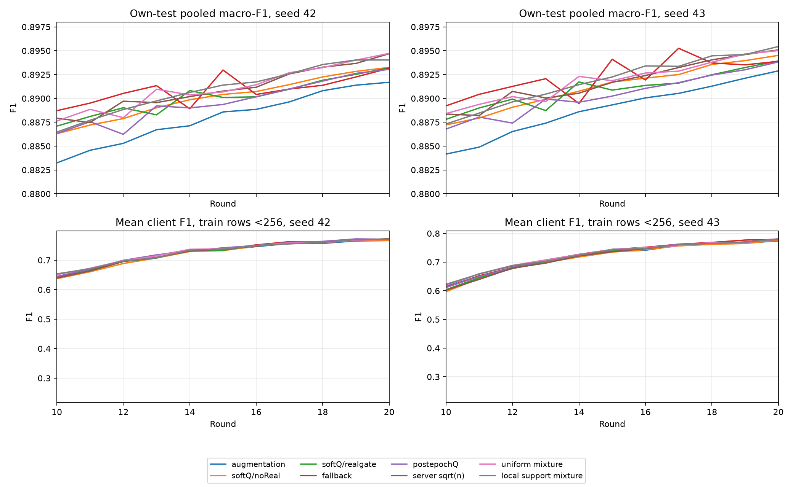

# M20 — kết quả và chẩn đoán, 01/11/2026

**16/16 run version1 hoàn tất và audit đủ20round.** Own-test từng xe là chính; chưa chốt phương pháp tổng.
Full5343xe, cosine50, seed42/43, DAGSNetW1; [thiết kế đãkhóa](screening-m20.md), [cơ chế](method.md).

## Bằng chứng và phạm vi

Pull1360file/12,371,633,095B (11.522GiB),56artifactđích/run. Source/config/LR/IDs/support/2×T4/compile2rank,320testCM,96trainCM,3264shadowprobe và320snapshot PASS. Qlag/fp16codec/synthetic-supportweight và externalpoolhash được đối chiếu từartifact. Không fullprivatebank/predictionreplay/exactresume hoặc fullcontentfingerprintdataset.
Bản làm việc nhẹ tại `evidence/m20`, `evidence/m20-summary`, `evidence/research-data`; snapshotđầyđủ khôi phục theo [backup](../operations/backup.md).

## Own-test tại round20

| cell | F1 seed42/43 | p10 seed42/43 | meanF1 xe<256 seed42/43 |
|---|---|---|---|
| augmentation | 0.891692/0.892889 | 0.691179/0.694910 | 0.766425/0.774221 |
| softQ/noReal | 0.893251/0.894513 | 0.692748/0.696686 | 0.766697/0.776268 |
| softQ/realgate | 0.893205/0.893932 | 0.697312/0.704757 | 0.772092/0.779774 |
| fallback | 0.893157/0.893887 | 0.698686/0.701056 | 0.770586/0.779411 |
| postepochQ | 0.893049/0.893827 | 0.698543/0.701028 | 0.770825/0.781230 |
| server sqrt(n) | 0.894687/0.895090 | 0.698341/0.702182 | 0.772368/0.778996 |
| uniform mixture | 0.894725/0.895010 | 0.697625/0.701555 | 0.770271/0.779950 |
| local support mixture | 0.894033/0.895440 | 0.695395/0.701255 | 0.770955/0.780411 |

M0–M15 theo thứtự bảng, hai seed/cell. Full10metric mọi round và16lớp cuối ở [phụ lục](metrics-m20.md).
Accuracy=precision_micro=recall_micro=recall_weighted=f1_micro trong single-labelclassification; giữ đủ10cột.

## Ba khâu: điều đã đo được

1. **Upload:** postepochQ so onlinegate ΔF1=−.000156/−.000104. Forwardcuốiepoch không tự tạo teacher hữuích hơn; đây là can thiệp timing+BN/dropout gộp, không kếtluận riêng staleness. Có thêm localforwardtime.
2. **Server:** sqrt(n_kc) so n_kc ΔF1=+.001482/+.001158, nhưng meanΔxe<256=+.000276/−.000778. Tăng pooled chưa giải quyết yêu cầu xe nhỏ; không gọi thêm đại diện là đủ.
3. **Client:** softQ/noReal vẫn hơnaugmentation+.001559/+.001624. Realgate đổi Δpooled=−.000046/−.000582 nhưng tăngtail/meanxe. Localρ so uniformpooled=−.000692/+.000429, p10 vàmeanxe giảm cảhai; riêng meanxe<256 tăngrất nhỏ+.000684/+.000461. Không chốt count-onlypersonalization thắng.

## Học tiếp và cơ chế đổi gate

Gatecontrol tăngF1r15→20 +.003102/+.003058; noReal +.002834/+.002796. Fallback chỉ+.000179/−.000213. Không bão hòa đồngloạt; mức tăng chậm vàranking phụthuộc endpoint. Gatexe<256 từkémaugmentationr10 sanghơn khoảng+.00567/+.00555r20. Không chọn best-round.

Qargmaxđúng chưa nghĩa teacher mạnh: tạiQr13, timeDelaytrueprob≈.49 vàbenign≈.47. Từ r14 bật lại realKD và đổi synthetic hard→soft cùnglúc; F1timeDelay giảm≈.07 ở cảhai seed. Qr14 sai→r15hardfallback phục hồi; Qr15đúng→r16giảm lại. Bảng dùng đúngteacherQr−1, không lấyQr đểgiải thích trainingr. Đây là bằngchứngtheothờigian, chưa tách nhân quả hai kênh.

| seed | round train | teacher round | Q13,13 | Q13,0 | gate giữ13 | timeDelay F1 |
|---|---:|---:|---:|---:|---|---:|
| 42 | 13 | 12 | 0.47490 | 0.48711 | False | 0.26990 |
| 42 | 14 | 13 | 0.49366 | 0.47120 | True | 0.20145 |
| 42 | 15 | 14 | 0.44651 | 0.51559 | False | 0.27853 |
| 42 | 16 | 15 | 0.53110 | 0.43908 | True | 0.21684 |
| 42 | 17 | 16 | 0.48637 | 0.48124 | True | 0.21077 |
| 43 | 13 | 12 | 0.47144 | 0.49072 | False | 0.26184 |
| 43 | 14 | 13 | 0.49009 | 0.47495 | True | 0.19084 |
| 43 | 15 | 14 | 0.44347 | 0.51869 | False | 0.27744 |
| 43 | 16 | 15 | 0.52781 | 0.44236 | True | 0.22064 |
| 43 | 17 | 16 | 0.48326 | 0.48448 | False | 0.28354 |

Fixedouterweight1 không cố định gradienttươngđối: ở một số xe probe r20, syntheticgradient lớn hơn realCE nhiều lần khi CE đãnhỏ. Đây chỉshadow34xe, không actualAMPgradient/clippingfraction; chưa là nguyênnhân duy nhất.

## Non-IID, thiếu lớp và tổng quát hóa

Nhóm848xe<256 có1555testrows absent-local và9776rows classcount1–16. Seed42, accuracytrên absentrows augmentation=.5267, gate=.4778, localρ=.4656; gate cải thiện tốt hơn trên lớp có nhiều mẫu. MeanF1xe tăng chưa bảo đảm nhận diện tốt lớp chưa gặp. Đây là accuracy điều kiện theo trueclass, không macroF1 mới.
Cross-client34xe chỉchẩn đoán phụ: augmentationmean≈.805 vs gate≈.785–.788, cùngpool/hashes/support. Không dùng để chọnHP hoặc thay own-test; dữ liệu này không được cấp cho training/teacher/kênhFL.

## Byte và thời gian

Q1088B/xe/r +3311744Bbootstrap =3333504B/xe/20r; augmentation3311744B. Bootstrap chi phối; chưa end-to-endtransport/ACK/secureaggregation proof. Giây làwalljob2×T4, khônglatencyxe. Chênh account không là causal speedup; postepochforward nằm trongt_train, không cộnghai lần.

| cell | train s/r seed42/43 (r2–20) | diagnostic tổng s seed42/43 |
|---|---:|---:|
| augmentation | 663.4/678.8 | 635.2/630.9 |
| softQ/noReal | 646.5/646.5 | 592.9/588.9 |
| softQ/realgate | 617.1/659.3 | 536.0/607.8 |
| fallback | 649.6/656.1 | 593.9/609.4 |
| postepochQ | 695.7/722.3 | 549.9/579.4 |
| server sqrt(n) | 616.9/625.0 | 550.3/546.3 |
| uniform mixture | 644.5/632.4 | 582.0/581.1 |
| local support mixture | 670.7/664.0 | 648.3/628.5 |

## Kết luận có giới hạn và bước tiếp

Hai seed vànhiềubatchđãđọc officialtest; không significance hoặc r>20/mixedarchitecture/contactdrop proof. Train+valđãfit, không independentvalidation. Không rawsharing nhưng chưa formalDP/secureaggregation.
Ưu tiên đối chứng tách chuyểnđổi realKD/synthetic, sauđó tách targetmixture khỏi realKDweight. Kiểm nội dung offdiagonalQ cóutility hơn chỉlabel-smoothing trước khi tăngpacket hoặc đổigenerator. Chi tiết [diagnosis](diagnosis.md); backup/cleanup xong mới khóa batch tiếp. Chưa launchthêm.
