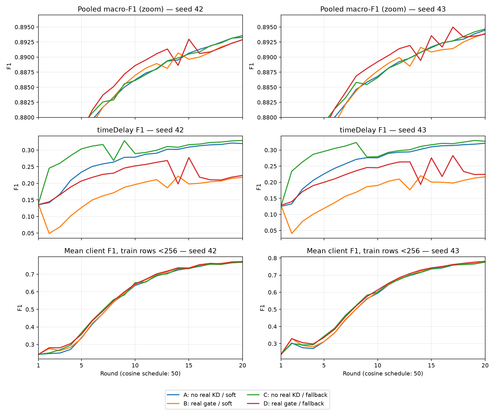

# N20 — factorial realKD × synthetic fallback, 01/11/2026

**8/8 run version1 đủ20round, artifact audit PASS.** RealKD tiếp tục đổi lợi ích giữa các lớp;
fallback có thể gây dao động cả khi tắt realKD. Chưa có phương án thắng đồng đều hoặc giải quyết tổng quát hóa.
[Thiết kế khóa](screening-n20.md), [cơ chế và reference đã thử](method.md), [đủ10metric](metrics-n20.md).

## Bằng chứng và phép so

784file,6.186.692.517B;160snapshot,160own-testCM,48trainCM,1632shadowprobe,
48externalCMarchive. Collector đã kiểm source/config/LR/ID/support/Qlag/codec/finite/snapshot/externalhash,
log2×T4/compile2rank và W&B online. Phiên nhận completion kiểm lại SHA cả160snapshot,
mọi file trong source manifest,160CM→10metric và support,48trainCM và scientific source closure so M.
Source core/method/driver/input/label/runtime trùng M; helper đóng gói có thêm, không thay loss/model.

Artifact `artifacts/n20/SLUG/SLUG`; receipt `runs/n-study/collection/{audit,diagnostic-audit}.json`;
phân tích `runs/n-study/analysis/{analysis.json,metrics-all-rounds.csv,teacher-tables.npz}`.
Tái tạo: `python scripts/analyse_n20.py`, rồi `python scripts/report_n20.py` trong env nckh, từ repo root.
N20 chưa được DVC backup; không xóa payload. Không có fullprivatebank/prediction→CM replay hoặc fullcontentfingerprintdataset.

Cell A=noReal/softQ, B=realgate/softQ, C=noReal/fallback, D=realgate/fallback; mỗi cell seed42/43.
Full5343xe, DAGSNetW1, endpoint20 mới, cosine50. Teacher cập nhật từng round từ train-only outputs,
dùng lag1; không phải neuralproxy hay teacher đóng băng cả quá trình. Q chung theo lớp, không biết input/client.
Mỗi cell có feedback Q riêng: phép so đo total effect của cơ chế FL, chưa giữ teacher cố định để isolate gradient.

## Own-test endpoint20

| cell / run | pooled F1 seed42/43 | mean client F1 | p10 client F1 | mean xe<256 |
|---|---|---|---|---|
| A N0/N1 | .893285/.894478 | .835016/.837687 | .695447/.701390 | .768031/.777533 |
| B N2/N3 | .892906/.893919 | .837190/.838889 | .699974/.703999 | .773263/.777586 |
| C N4/N5 | .893577/.894672 | .834902/.837092 | .695756/.698382 | .768481/.775879 |
| D N6/N7 | .892885/.893814 | .836264/.839058 | .697182/.702083 | .771299/.780527 |

## Factorial: realKD và fallback không có lợi ích cộng đơn giản

Chênh tuyệt đối F1; thứ tự seed42/43. “Other15” là mean F1 pooled của15lớp trừ timeDelay, không metric headline mới.

| đối chiếu | Δpooled | ΔtimeDelay | Δother15 | Δmean client |
|---|---|---|---|---|
| B−A: realKD dưới softQ | −.000379/−.000559 | −.101515/−.104247 | +.006363/+.006353 | +.002174/+.001202 |
| D−C: realKD dưới fallback | −.000692/−.000857 | −.105239/−.102833 | +.006278/+.005941 | +.001362/+.001966 |
| C−A: fallback khi noReal | +.000292/+.000194 | +.009300/+.006282 | −.000308/−.000212 | −.000114/−.000595 |
| D−B: fallback khi realKD | −.000021/−.000104 | +.005576/+.007696 | −.000394/−.000624 | −.000926/+.000169 |
| interaction=(D−C)−(B−A) | −.000313/−.000298 | −.003723/+.001414 | −.000086/−.000412 | −.000812/+.000764 |

RealKD làm giảm timeDelay khoảng.10 ở cảhai syntheticpolicy, đồng thời nâng other15 và mean/p10 client.
Không nên tắt toàn bộ KD chỉ từ pooledF1. B−A có2663/2591xe tăng và2381/2425xe giảm;
D−C có2631/2667xe tăng và2413/2350xe giảm; số còn lại bằng theo tolerance1e−12.
Gains C−A nhỏ, meanclient giảm cảhai seed, p10 giảm seed43; chưa chọn C làm phương pháp thắng.
Interaction pooled cùng âm nhưng interactiontimeDelay/mean/cohort không cùng dấu hai seed;
không gọi mọi tương tác đều bất lợi hoặc cộng gains từ M để dự đoán combo.

## Dao động có hai nguồn can thiệp; chưa là plateau toàn hệ thống

| cell | ΔF1r15→20 seed42/43 | slope F1/r r11–20 seed42/43 | số flip correctargmax lớp13 của Q1…Q19 |
|---|---|---|---|
| A | +.002627/+.002772 | .000682/.000672 | 1/1 |
| B | +.003262/+.003063 | .000512/.000532 | 3/3 |
| C | +.003061/+.003108 | .000695/.000724 | 3/1 |
| D | −.000090/+.000253 | .000290/.000414 | 3/5 |

Pooled panel zoom. A/B/C vẫn tăng r15→20; D gần đứng endpoint đoạn cuối, không chứng minh hết khả năng học sau20round.

**Fallback có dao động khi không realKD:** C seed42 dùng Q7 ởr8, margin lớp13 chỉ+.001465;
synthetic target từ onehot sang Q làm L1jump1.0335, timeDelayF1 giảm.04828. Q8 sai→r9 hardtarget,
F1 tăng.05982; Q9 đúng→r10 giảm.03907. Seed43 đổi sang soft ởr9 làm F1 giảm.04501, sau đó hồi phục.
Vì C không realKD, bác bỏ “chỉ realKD mới tạo dao động”. C không có chatter muộn giống D;
không suy bỏ realKD sẽ xóa mọi dao động hoặc riêng fallback đủ gây plateau muộn.

**RealKD dưới soft vẫn có dao động:** B dùng Q12 đúng→r13 giảm timeDelay.02471/.03324;
Q13 sai→r14 tăng.03534/.04364. Synthetic target luôn soft; ngưỡng realgate không được fallback giải thích thay.
**Kết hợp D:** Q13 đúng→r14 giảm.07055/.07000; Q14 sai→r15 tăng.07948/.08245.
Các bước Q→target trực tiếp kiểm được từ công thức; liên hệ với metric là theo thời gian trong feedbackFL,
chưa isolate nhân quả riêng gate dưới cùng teachertrajectory.

**Không chỉ gate lớp13:** B round2 timeDelayF1=.048735/.040784, A=.141769/.132803;
Q1 lớp13 argmaxbenign nên realKD trực tiếp cho dòng trueclass13 đã bằng0. B Q1…Q11 đều reject13.
Vì thế bật realKD các lớp khác vẫn có total effect lớn lên decisionboundary/teacherfeedback của13.
Đây là bằng chứng chống giải thích “chỉ teacher13 sai nhưng gate13 mở”; chưa tách tác động từng lớp,
sharedparameters, offdiagonal, BN hay feedback. Gate margin riêng13 không đủ để tuyên bố đã giải quyết nguyên nhân.

## Xe nhỏ, thiếu lớp và gap train–test

848xe<256trainrows;1555testrows absentlocal,9776rows classcount1–16,23496rows classcount>16.
Accuracy điều kiện trên absentrows: A=.524759/.545338, B=.470740/.491961,
C=.531833/.527331, D=.484244/.499678. Nâng mean/p10 không tự nâng lớp chưa gặp.
Xe nhỏ chỉ2–4step/r như phân tích M, không tăng hiệu quả bằng count-onlyKD đã được chứng minh.

Recall timeDelay trên cùng xe/lớp đã thấy, cân theo test support481868rows:

| cell | trainrecall seed42/43 | own-testrecall seed42/43 |
|---|---|---|
| A | .8398/.8442 | .2383/.2398 |
| B | .6941/.6923 | .1331/.1323 |
| C | .8454/.8473 | .2530/.2512 |
| D | .6707/.6661 | .1390/.1398 |

Xe≥4096rows vẫn có gap lớn: C train≈.839/test≈.255, B train≈.675/test≈.134.
Thiếu mẫu/lớp không giải thích toàn bộ. Train+val đãfit; gap chưa phân biệt overfit, temporalshift hoặc featureoverlap.
Chưa đủ bằng chứng để dùng confidence/in-sampleaccuracy làm serverqualityweight.

Shadow34xe r20: median synthetic/realCE gradientnorm≈1,93–2,95 tùy cell, max≈6,19–13,59.
Outerweight1 không cố định ảnh hưởng gradient khi localCE giảm; shadowfp32/dropout0/trainBN không là actualAMPgradient toàn mạng.
Cross-client diagnostic34xe r20: A=.79409/.79817, B=.78513/.78613, C=.79660/.79606, D=.78606/.78991;
secondary, evaluator only, không vào train/Q/bootstrap hoặc dùng chọnHP.

## Byte và thời gian

Mọi cell:544B/chiều/xe/r,1088B hai chiều; bootstrap3311744B;20round tổng3333504B/xe.
Bootstrap≈99,35% tổng hiện tại; chưa tính transport/ACK/secureaggregation và chưa thử contactdrop.
Không rawrows/features/per-rowlabels/privateweights trong FLmessages; thống kê gộp chưa có bảo đảm DP.

| cell | train s/r r2–20 seed42/43 | train tổng s | eval tổng s | diagnostic tổng s | notebooklog elapsed s |
|---|---|---|---|---|---|
| A | 653.8/643.8 | 13169.9/12980.2 | 644.5/623.4 | 594.9/584.8 | 16212.0/15315.3 |
| B | 642.3/652.3 | 12955.1/13153.3 | 645.4/655.7 | 606.2/610.1 | 14839.4/16092.9 |
| C | 646.2/655.4 | 13026.5/13212.0 | 636.9/642.3 | 602.8/610.2 | 16152.5/15119.5 |
| D | 645.6/650.6 | 13014.9/13116.2 | 659.8/647.1 | 622.9/616.7 | 15350.3/15013.4 |

Giây wall của job2×T4; notebooklog elapsed còn gồm setup/compile/IO/conversion, chưa gồm queue hay collectlocal,
không phải latency mỗi xe hoặc causal speedup giữa account. Maxskipfraction≤1,706e−6/round, không có bằng chứng training treo.

## Kết luận và kiểm chứng tiếp

Ưu tiên **tiếp nhận tri thức đúng chỗ**, không tăng KD đồng loạt hoặc tăng packet trước:
kiểm gate liên tục riêng từng kênh; dùng teacherreplay để tách crossclass/feedback và nội dung offdiagonal;
đồng thời cần foldvalidation train-only để kiểm gap tổng quát hóa. Chi tiết/falsifier ở [diagnostic-next](diagnostic-next.md).
Đây là adaptation/ablation dự án trên cơ chế đã reference tại method.md, chưa gán thêm bài báo chưa thử.

Hai seed chưa significance; sameclient tương quan giữa seed. Cùng công thức R1 nhưng sessionF1spread≈.000244/.000538,
không CI/noisebound; smallgain C−A cần xác nhận, không mặc định bằng noise. Officialtest đã đọc qua nhiều batch,
không gọi freshconfirmatorytest. Không best-round, r>20, mixedarchitecture hoặc formalprivacyproof. Không launch thêm từ completion này.
