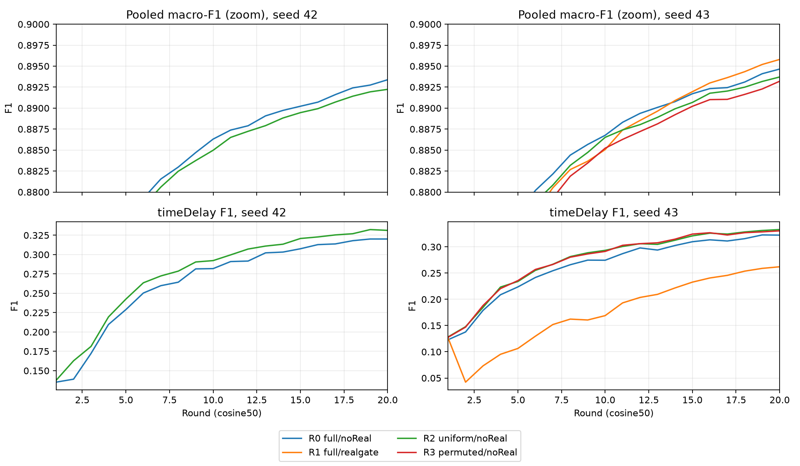

# O20 — audit sớm và phân tích một phần batch

**6/8run đã audit; chưa đủ mọi cặp seed.** 612file/4,641,881,084B; SHA20snapshot/run, mọi file source, scientificclosure so N và20CM→10metric/support đã đối chiếu độc lập.
Fullaudit còn gồm finite/probe/externalhash/teacherlag/rawQ/target. Không privatebank/predictionreplay/fullcontentfingerprintdataset hoặc DPproof.
[Thiết kế khóa](screening-o20.md), [cơ chế/reference đã thử](method.md). R0=fullQ/noReal, R1=fullQ/realgate, R2=uniform/noReal, R3=permuted/noReal.
Own-test5343xe, endpoint20/cosine50, W1; Q nguồn train-only N0/N1, dùng lag1, không livefeedback từ Q_live.

## Own-test tại round20

| arm / cell / seed | pooledF1 | mean clientF1 | p10 | mean xe<256 | timeDelayF1 | ΔF1r15→20 |
|---|---:|---:|---:|---:|---:|---:|
| O0/R0/42 | 0.893383 | 0.834585 | 0.695345 | 0.767510 | 0.320134 | +0.003161 |
| O1/R0/43 | 0.894653 | 0.837897 | 0.701808 | 0.780438 | 0.322362 | +0.002940 |
| O3/R1/43 | 0.895800 | 0.839676 | 0.701139 | 0.780116 | 0.262050 | +0.003842 |
| O4/R2/42 | 0.892237 | 0.834939 | 0.697408 | 0.772334 | 0.331264 | +0.002777 |
| O5/R2/43 | 0.893710 | 0.837303 | 0.700742 | 0.782280 | 0.332957 | +0.003033 |
| O7/R3/43 | 0.893202 | 0.835523 | 0.699552 | 0.777437 | 0.330548 | +0.002985 |

## Đối chiếu cùng teacher nguồn

Chênh tuyệt đối endpoint20. Other15=mean pooledF1 của15lớp trừ timeDelay; không headline mới.

| contrast / seed | ΔpooledF1 | Δmean client | Δp10 | Δmean xe<256 | ΔtimeDelay | Δother15 | xe tăng/giảm |
|---|---:|---:|---:|---:|---:|---:|---:|
| O4-O0 uniform/42 | -0.001146 | +0.000353 | +0.002063 | +0.004825 | +0.011131 | -0.001965 | 2473/2579 |
| O3-O1 real_gate/43 | +0.001147 | +0.001780 | -0.000669 | -0.000322 | -0.060312 | +0.005244 | 2757/2267 |
| O5-O1 uniform/43 | -0.000943 | -0.000594 | -0.001066 | +0.001843 | +0.010596 | -0.001713 | 2410/2639 |
| O7-O1 permuted/43 | -0.001451 | -0.002374 | -0.002257 | -0.003001 | +0.008187 | -0.002094 | 2336/2710 |

FullQ vs uniform thay cả entropy; fullQ vs fixedpermutation giữ diagonal/entropy nhưng phá tên lớp.
UniformO giữ diagonal/chia đều offdiagonal, khác uniformM12 trộn hard/softρ=.5; không cộng gain hai can thiệp.
Không realKD ở uniform/permuted nên argmax sau biến đổi không mở gate. Permutation chỉ một phép đã khóa, chưa kiểm nhiều permutation.
Sameclient giữa seed có tương quan; hai seed chưa significance. Không gọi pooledgain là mọi client được lợi.

## Tripwire replaycontrol so N0/N1

| control | Δpooled | ΔtimeDelay | Δp10 | Δmean xe<256 | giới hạn khóa |
|---|---:|---:|---:|---:|---|
| O0 | +0.000098 | +0.000515 | -0.000101 | -0.000522 | PASS |
| O1 | +0.000175 | +0.001366 | +0.000418 | +0.002905 | PASS |

Giới hạn đã khóa trước O: |Δpooled|≤.001, ba metric còn lại≤.01. Không CI/noisebound/utilitythreshold; không bitexact giữa T4sessions.

## Xe nhỏ và tổng quát hóa

Accuracy điều kiện trên1555absent-localtestrows của848xe<256; không macroF1 mới.

| arm | absentaccuracy xe<256 | matched trainrecall timeDelay | matched testrecall timeDelay | cross-client34 meanF1 (phụ) |
|---|---:|---:|---:|---:|
| O0 | 0.531833 | 0.841983 | 0.238242 | 0.795085 |
| O1 | 0.540193 | 0.847079 | 0.241400 | 0.797958 |
| O3 | 0.488103 | 0.761872 | 0.173730 | 0.794474 |
| O4 | 0.559486 | 0.857803 | 0.262653 | 0.800705 |
| O5 | 0.542765 | 0.857157 | 0.263477 | 0.803132 |
| O7 | 0.528617 | 0.848708 | 0.262854 | 0.802889 |

Matchedrecall cân theo supporttest481868rows cùng xe/lớp đã thấy; train+val đãfit, không independentvalidation.
Gap không tự tách overfit/temporalshift/featureoverlap. External34 chỉ evaluator, không vào train/Q/bootstrap và không dùng chọnHP.

## Byte và thời gian

Mọi run: packet-equivalent3333504B/xe/20round; offlinepreload3402795B gồm3311744bootstrap+10880uplink+80171Binputmodule.
Không cộng lại cached downlink hoặc cộng cả decoded61440B và cùng module như hai lượt tải. Replay là counterfactual, chưa liveFL/contactcostproof.

| arm | train s/r r2–20 | train tổng s | eval tổng s | diagnostic tổng s | notebooklog elapsed s |
|---|---:|---:|---:|---:|---:|
| O0 | 648.8 | 13073.9 | 636.1 | 608.2 | 15946.7 |
| O1 | 630.1 | 12718.4 | 638.1 | 570.5 | 14863.0 |
| O3 | 644.5 | 12989.3 | 613.1 | 578.4 | 15303.7 |
| O4 | 647.1 | 13043.6 | 625.7 | 576.5 | 15069.0 |
| O5 | 631.3 | 12735.1 | 614.5 | 557.0 | 14757.6 |
| O7 | 651.4 | 13129.9 | 628.5 | 590.7 | 15431.4 |

Giây walljob2×T4, không latency mỗi xe. Notebookelapsed gồm setup/compile/IO/conversion, chưa queue/collectlocal.
Đủ10metric mọi round và16lớp cuối: [phụ lục](metrics-o20-early.md). Officialtest đã đọc nhiều batch; không freshconfirmatorytest/best-round/HPtuning.
Chưa r>20/mixedarchitecture/DP proof; không chọn phương pháp tổng từ replay. Artifact mới chưa DVCbackup, giữ local.

Nguồn phân tích: `runs/o-study/early-collect-20261101/analysis/analysis.json`; tái tạo `python scripts/analyse_o20.py --early`, rồi `python scripts/report_o20.py --early`.
