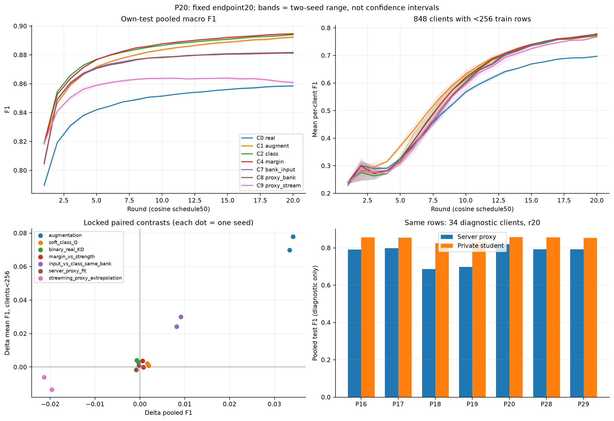
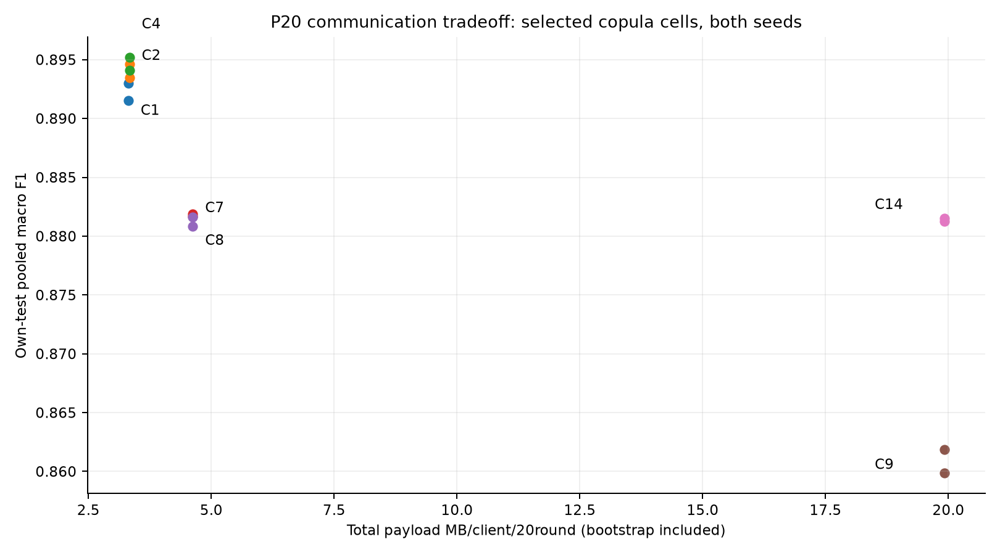

# P20 — kết quả và hệ quả cho phương pháp

Đã [pull/audit toàn bộ32run](audit-p20.md) trước phân tích:31run đủ20round, P21 lỗi trước round1.
16cell giữ5343xe/DAGSNetW1/cosine50/seed42–43. C10 chỉ còn seed42; không nội suy hoặc coi probe1round là seed43.
Số dưới đây là F1 dạng0–1. [Đủ10metric](metrics-p20.md), [byte và thời gian từng run](cost-p20.md),
thiết kế/tham khảo gắn với thành phần đã triển khai tại [P20](screening-p20.md).

## Endpoint20

| cell | pooled F1 s42/s43 | mean F1 xe<256 s42/s43 | total MB/xe/20r |
|---|---|---|---:|
| C0 real | 0.858166/0.858833 | 0.697037/0.696840 | 0.000128 |
| C1 augment | 0.891552/0.893005 | 0.766928/0.774698 | 3.311744 |
| C2 class | 0.893495/0.894642 | 0.767830/0.776761 | 3.333504 |
| C3 gate | 0.893145/0.893940 | 0.770693/0.780711 | 3.333504 |
| C4 margin | 0.894115/0.895173 | 0.772963/0.779908 | 3.333504 |
| C5 strength | 0.893512/0.894429 | 0.769229/0.780059 | 3.333504 |
| C6 bank_class | 0.872593/0.873709 | 0.746198/0.756422 | 3.978624 |
| C7 bank_input | 0.881688/0.881862 | 0.776180/0.780570 | 4.623744 |
| C8 proxy_bank | 0.880840/0.881622 | 0.774552/0.781504 | 4.623744 |
| C9 proxy_stream | 0.859878/0.861854 | 0.765327/0.770177 | 19.915264 |
| C10 proxy_hybrid | 0.891047/thiếu | 0.775380/thiếu | 4.623744 |
| C11 bank_hard | 0.886115/0.884406 | 0.769458/0.771098 | 3.311744 |
| C12 project_augment | 0.891977/0.892912 | 0.765822/0.771682 | 3.311744 |
| C13 project_class | 0.893465/0.894179 | 0.768044/0.777564 | 3.333504 |
| C14 proxy_weights_bank | 0.881248/0.881540 | 0.771408/0.783576 | 19.915264 |
| C15 real_no_la | 0.857291/0.858794 | 0.698535/0.694761 | 0.000000 |

MB thập phân, gồm bootstrap và hai chiều20round. C0/C15 không copula; augmentation vẫn dùng thống kê toàn mạng,
không phải local-only. Có tradeoff giữa pooled, meanxe, p10, lớp hiếm/chưa thấy; chưa chọn một phương pháp tổng.

Band là min–max hai seed, không confidence interval. Teacher/student panel dùng cùng9721testrow của34xe diagnostic,
không đại diện toàn mạng và không tham gia train/chọnweight. Shadowgradient không actualAMPgradient/clippingrate.

## 1. Thông tin toàn mạng đã hữu ích; phần lớn gain hiện đến từ synthetic augmentation

C1−C0 tăng pooled **+.033386/+.034172**, meanF1 nhóm848xe<256 tăng **+.069891/+.077858**.
LocalCE với hoặc không LA đều đạt accuracy0 trên1555testrow thuộc lớp không có trong train của nhóm này;
augmentation đạt **.533119/.535691**. Kiến thức toàn mạng giúp lấp khoảng trống lớp, dù không chia sẻ mẫu thật.

ClassQ vẫn thêm utility: C2−C1 pooled **+.001943/+.001637**, meanxe<256 **+.000902/+.002063**;
không kết luận distillation vô ích vì augmentation mang gain lớn hơn. O20 đã cho thấy offdiagonalidentity có utility;
không thay Q bằng nhãn cứng hoặc bỏ quan hệ lớp chỉ vì packet nhỏ.

LA/prior riêng C0−C15 chỉ tăng pooled+.000875/+.000039, nhómxe nhỏ đổi trái dấu.
LA không thay được thông tin về lớp chưa thấy. Các gain là total effect trên cấu hình đang thử, không phân rã tỷ lệ nhân quả.

## 2. Input-dependent target có ích, nhưng bank và phạm vi teacher vẫn giới hạn

C7−C6 giữ cùng bank/uplink/scorer: chuyển classmean sang target từng input tăng pooled **+.009095/+.008153**,
meanxe<256 **+.029982/+.024148** và p10 **+.031775/+.028296**. Nén mọi mẫu cùng lớp thành một Qrow
làm mất thông tin hữu ích trong matched-bank setting.

Tuy nhiên C7 vẫn chỉ .881688/.881862, thấp hơn streamingC2 .893495/.894642.
Ngay cả khi bỏ learnedteacher, bankhardC11 thấp hơn streaminghardC1 **−.005437/−.008599 pooled**.
Vì vậy không quy toàn bộ khoảng cách cho biểu diễn teacher: cách tái dùng/sinh support và lịch lấy mẫu cũng cần kiểm.
Bank refresh mỗi round vẫn chỉ có64input/lớp tại một thời điểm. Đây chưa là proof rằng kích thước bank là nguyên nhân duy nhất;
khác RNG/support và livefeedback vẫn có thể góp phần.

C7 so bankhardC11 tăng meanxe<256+.006722/+.009472 nhưng giảm pooled−.004427/−.002544.
Ngay cả inputteacher cũng có tradeoff giữa nhóm xe; không nhận phương pháp chỉ từ teacheragreement hoặc meanxe.

## 3. Server proxy hiện chưa tạo ra teacher tốt hơn ensemble

C8−C7 pooled **−.000848/−.000241**; lợi xe nhỏ trái dấu, p10 trái dấu.
Fit một DAGSNet vào output ensemble chưa thêm utility rõ ràng trong protocol này.

Trên cùng34xe diagnostic tại r20, proxyC8 có testF1 **.790386/.798265**, student tương ứng **.856093/.855271**.
Seed42 có251row teacher đúng/student sai, nhưng476row student đúng/teacher sai; seed43 là286/447.
Đây là cơ hội/rủi ro từ dự đoán tại cùng input, **không phải số lỗi KD thực sự gây ra** vì batch này proxy chỉ dạy synthetic.
Proxy không đủ tốt trên phạm vi real diagnostic để mặc định kéo mọi xe mạnh hơn về teacher.
Không so các số này với Q[y_true] như cùng một classifier: classQ phụ thuộc nhãn thật, không tự dự đoán từ input.

C10hybrid thêm .5nhãn synthetic ở server tăng+.010208 pooled so C8 seed42, đạt .891047,
nhưng vẫn chưa hơn streamingC2 seed42. Thiếu seed43 nên chỉ giữ giả thuyết về semanticprior, chưa nhận cải tiến.
Không suy nhãn synthetic luôn đúng, hoặc tăng syntheticagreement là tăng chất lượng thật.

C9 dùng proxy trên streaminginputs giảm pooled **−.021370/−.019685** so C14 matchedcarrier-bank,
meanxe<256 cũng giảm. Proxy học trên một bank không được chứng minh tốt trên input mới.
Đây là live total effect gồm support và teacherfeedback; cần replay cùng lịch teacher trước kết luận riêng về extrapolation.

## 4. Cách học client cần bảo vệ cả lớp đã thấy và chưa thấy

BinaryrealKD C3−C2 tăng meanxe<256+.002862/+.003950, nhưng giảm pooled−.000350/−.000703,
timeDelayF1 **−.103591/−.102528**; other15F1 tăng+.006533/+.006086.
Accuracy trên1555absentrow của xe nhỏ giảm từ **.533119/.543408 xuống .478457/.488103**.
MeanF1 tốt hơn chưa đồng nghĩa mỗi xe nhận diện rộng hơn.

MarginC4 hơn binarygateC3 pooled **+.000970/+.001233**, hơn strengthcontrolC5 **+.000603/+.000744**.
Nhưng meanxe<256 và p10 không hơn cảhai seed. So C3, margin phục hồi timeDelay+.028558/+.025874,
đồng thời other15 giảm nhẹ−.000869/−.000409. Margin không đơn thuần nâng mọi lớp.
Absentscore C4 chỉ .481672/.491961, vẫn dưới C2. Chưa có bằng chứng để tăng KD theo count cho mọi xe khó.

Kết quả tương thích với ảnh hưởng giữa các decisionboundary/feedback, không chỉ teacherargmax sai của đúng lớp đó;
N/O đã cho thấy lớp13 vẫn bị hại khi directgate13 đóng. Chưa tách riêng gradient/BN/crossclass thành nguyên nhân duy nhất.
M12/M14 đã thử mixture/countρ; không đưa lại một phép trộn hard/soft hoặc tăng KD theo ít mẫu như phát kiến mới.

## 5. Chững sớm không phải hiện tượng chung; còn gap tổng quát hóa ngoài KD

C2 tăng pooled r15→20 **+.003093/+.003434**; meanxe<256 tăng **+.034424/+.038880**.
Xe nhỏ vẫn học tiếp đáng kể. C9 pooled giảm−.002811/−.003312 trong khi meanxe<256 vẫn tăng;
không gọi cả hệ thống plateau chỉ từ một đường pooled hoặc một nhánh proxy.

Gap timeDelay tồn tại cả xe nhiều mẫu: C2 trên nhóm>=4096, cùng xe/lớp và cân theo supporttest,
trainrecall **.834708/.837083**, testrecall **.242368/.242854**.
Local-only cũng có gap lớn, nên không quy mọi sai sót cho teacher. In-sampletrain chưa phân biệt overfit,
temporal/context shift và featureoverlap. Hiện train+val đều đã học, chưa có independentvalidation.

Projection đúng6NaNflag sửa fidelityconstraint nhưng không tăng pooled ổn định:
C12−C1 +.000425/−.000093, C13−C2 −.000029/−.000463. Không chứng minh generator jointdistribution đã đúng,
cũng không đủ bằng chứng mở lại GMM/MADE/BNsplit/head-only từng fail ở v1 khácdataset.

## 6. Chọn thông tin giao tiếp theo utility, không theo kích thước teacher

- C2/C4: **3.333504MB/xe/20r**, trong đó bootstrap3.311744MB, khoảng99.35% tổng byte.
- C7/C8: **4.623744MB**, inputuplink/downlink32768Bbody+32Bheader/chiều.
- C9/C14: **19.915264MB**; modeldownlink797376B/r so32800B/r khi gửi output trên1024query.
- Carriercontrol C14−C8 qua tripwire cảhai seed, không bitexact hoặc significance. Cùng teacher trên bank,
  carrier model tăng tổngbyte khoảng4.31× mà chưa có utility ổn định. Gửi output phù hợp hơn trong setting này.
- C9 vừa tốn byte hơn vừa kém C8/C14 về pooled. Chưa có lý do dùng downlinkproxyweights làm mặc định.

Tổng walltime logC2 khoảng4.46/4.53h, C9 khoảng4.83/5.27h; không là latency một xe.
Time chịu setup/compile/diagnostic/máy Kaggle; không quy mọi chênh session cho method.
Phân rã byte/time đầy đủ ở [bảng chi phí](cost-p20.md); server/scoring đã nằm trong train, không cộng hai lần.

## Định hướng phương pháp và kiểm chứng tiếp

**Control hiện tại:** streamingcopula + compactclassQ, giữ cấu trúc offdiagonal; clientDAGSNetW1 để so baseline.
**Hướng nghiên cứu:** teacher theo input với support đa dạng và downlink output nhỏ, chỉ khi chứng minh tốt trên realvalidation;
localobjective phải cân bằng localfit, nhómxe yếu và lớp chưa thấy. Chưa chọn margin hoặc proxy làm phương pháp cuối.

| ưu tiên | evidence → kiểm chứng | dấu hiệu bác bỏ / giới hạn |
|---|---|---|
| 1 | Hoàn tất C10seed43: P21 chưa round1; chạy lại đúng cấu hình đã khóa, failfast khi compilegate lỗi, capture nonfinite, giữ evidence cũ | Không gọi diagnostic1round là20round; không đổiHP để tìm win |
| 2 | Thiết kế temporalvalidation train-only, fitbootstrap/scaler/generator trên foldtrain; áp dụng cùng protocol cho controls trước qualityweightserver | Nếu không giữ được split sạch, chưa dùng confidence/quality để weight; không dùng officialtest làm gate |
| 3 | Replay cùng proxytrajectory C8, cùng carrier/codec: bankqueries vs streamingqueries; tách support khỏi feedback | Nếu gap mất khi cùngteacher, không quy mọi lỗi cho extrapolation; offlinepreload không là liveFLsaving |
| 4 | Sau khi xác nhận coverage: server nhớ query/target từ nhiều bank luân phiên, giữ uplinkbudget và serversteps; đối chứng tuổi target/staleness | KL/agreement đẹp nhưng realvalidation/weakclient không tốt hơn thì không nhận teacher |
| 5 | Client: tách realKD khỏi syntheticknowledge; thử bảo vệ gradient localCE trước realKD xung đột, so strengthcontrol và cùngteacher | Bảo vệ localCE bậc một không bảo đảm absentclass; phải báo rare/absent/strongclient và chi phí backward thêm |
| 6 | Khi inputtargets có utility: so query luân phiên/diversity và packetcompression cùngbyte; thêm reliabilitysummary lớp từ validation sạch | Disagreement/confidence không tự nghĩa đúng; không tăng byte khi chưa chứng minh thông tin mới hữu ích |

Uploader chỉ gửi thống kê gộp/output trên synthetic chung, server giữ tri thức và gửi target cần thiết;
không mẫu thật, feature/nhãn từng dòng hoặc privateweights trong FLmessages. Không có formalDP/secureaggregation proof.
Schema không phụ thuộc tham số model client, nhưng batch hiện toànDAGSNet; heterogeneousarchitecture chưa kiểm thực nghiệm.

Không nhận “đã thắng benchmark”: [tham chiếu r20](benchmark-r20-reference.md) APFedclient seed42F1=.902965,
meanxe=.870260/p10=.760997, vẫn trên C4seed42 (.894115/.838307/.699480). Đây là tham chiếu cùnghorizon/model,
kế thừa auditbounded khácrepo, không đối chứng nhân quả hay significance. Có khoảng cách chất lượng cần giải quyết.

Hai seed chưa đủ significance, officialtest đã đọc nhiều batch; không freshconfirmatorytest, không r>20proof.
Full analysis/provenance: `runs/p-study/analysis/{analysis.json,metrics-all-rounds.csv,costs.csv}`.
