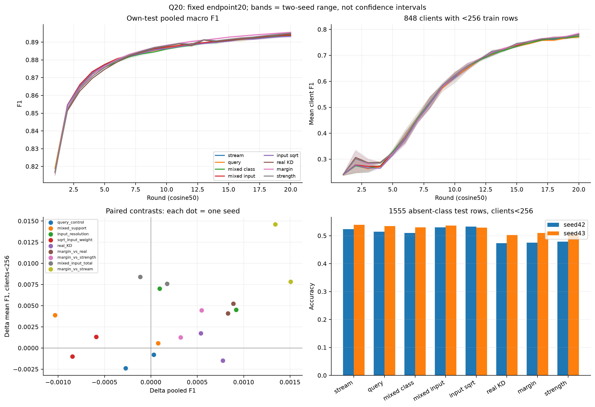
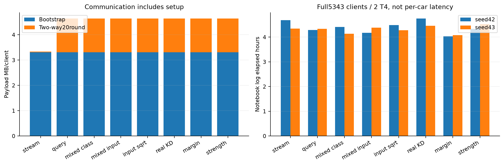

# Q20 — kết quả, nguyên nhân còn lại và hướng phương pháp, 02/11/2026

**Inputtarget giúp xe yếu trong matchedsupport; margin cải thiện pooled/mean/p10, nhưng vẫn hại absentclass/timeDelay.**
Server sqrt(count) chưa giúp trong pipeline này. Chưa có cơ chế nâng mọi xe hoặc lý do đổi kiến trúc client.

Đã pull/audit đủ16exactversion1/8cell×seed42–43, mỗi run20round/full5343/DAGSNetW1/cosine50;
train+val37361273/test9347679, protocol không đổi. [Thiết kế đã khóa](screening-q20.md),
[đủ10metric mỗi round](metrics-q20.md), [byte/time từng run](cost-q20.md).
Teacher Q20 là onlineclassQ + perinputtargets trên synthetic chung, không serverproxy/modeldownlink.

## Gate audit đã đóng

Worker collect-only succeeded04:47:49+07; closure16PASS_BOUNDED,0trainingfailure/0run thiếu.
Đã kiểm artifact thực và receipt:1920file/12991878138B,48sourcefile/run đúng baseGit/11overlay,
320own-testCM/320finite snapshot/96trainCM,3264shadowclientprobe và external34xe tại1/10/20.
Compileguard hai T4 PASS, skippedfraction0; source/config/LR/ID/support/teacherlag/aggregate/body/byte/guard đã audit.
Bank cùng seed/round khớp SHA giữa các variant; điều này không chứng minh privateupdates giữa các session bitexact.

Worker trước từng dừng ở checker CPU/CUDA normalize Q5/Q6/Q9; giữ log/checker/progress gốc,
sửa khoảng rounding theo storedfp16body và fp32sum/division,7regressiontest gồm targetcorruption PASS.
100snapshot đãpull khớp decodeCUDA local; tái audit5run trước collect-only phần còn lại.
Không đổi source train/HP/artifact, không trainlại. Chi tiết/SHA tại `runs/q-study/audit-recovery-20261102/`.

`runs/q-study/closure-verification.json` khóa artifact/source/snapshot/reportSHA;
`runs/q-study/analysis/analysis.json` tính lại320CM và các đối chứng. PASS_BOUNDED không bao gồm
prediction→CM replay, fullprivatebank/reconstruction/resume, fullcontentfingerprint, DP/SecAgg, mixedarchitecture hoặc contactproof.

## Endpoint20

F1 dạng0–1. Meanxe<256 gồm848xe; p10 là phân vị F1 của toàn5343xe, macro mỗi xe trên lớp có trong y_true.

| cell | pooled F1 s42/s43 | mean xe<256 s42/s43 | p10 s42/s43 | MB/xe/20r |
|---|---|---|---|---:|
| S0 stream | .893602/.894563 | .769142/.776854 | .692514/.696895 | 3.333504 |
| querycontrol | .893328/.894593 | .766756/.776057 | .696322/.701532 | 4.645504 |
| S1 mixedclass | .893406/.893560 | .767334/.779947 | .689240/.694508 | 4.645504 |
| S2 mixedinput | .893501/.894477 | .774344/.784465 | .698552/.704844 | 4.645504 |
| S2sqrt | .892655/.893888 | .773336/.785781 | .700517/.701330 | 4.645504 |
| S2real | .894277/.895014 | .772882/.786223 | .697995/.704348 | 4.645504 |
| S2margin | .895108/.895903 | .776984/.791461 | .703855/.708131 | 4.645504 |
| S2strength | .894790/.895358 | .775711/.786998 | .702915/.704442 | 4.645504 |

Band là min–max hai seed, không confidenceinterval. Chấm endpoint20, không lấy besttest round hoặc tune bằng officialtest.

## 1. Control chấp nhận được cho screening, chưa bitexact hoặc noisebound

query−stream pooled=−.000274/+.000030; p10=+.003808/+.004637;
meanxe<256=−.002386/−.000796; timeDelay=−.002021/+.001363.
Cảhai seed qua tripwire đã khóa: pooled≤.001, các chỉ số còn lại≤.01 về trị tuyệt đối.
Stream mới so P/C2 cũng qua tripwire; pooled+.000107/−.000079.

Localpreflight hai seed/3round bitexact không chuyển thành remote full5343 bitexact:
CM/Q đã khác ngayr1; các ô mixed cùng hardobjective r1 có spreadpooled .000584/.000719.
Không giữ fullprivateweights để kiểm identity của mọi xe. Các kiểm tra source/RNG ở fixture vẫn có giá trị đúng phạm vi.

Ngay querycontrol cũng có1227xe deltaF1<−1e−12 ở cảhai seed;409xe giảm>.01 và29xe giảm>.05 ở cảhai seed.
Vì vậy số delta âm hoặc hai seed cùng dấu chưa tự chứng minh từng xe bị cơ chế gây hại.
Các ngưỡng .01/.05 ở đây là chẩn đoán mô tả sau test, không gate nhận method/HP hoặc estimate significance/noisebound.

## 2. Chỉ trộn support chưa đủ; target theo input mang utility cho xe yếu

S1−query giữ cùng gói/scoring và64synthetic/step, thay32rowstream bằng bank:
pooled+.000078/−.001034, p10−.007081/−.007023. Supportmix riêng chưa là cải thiện ổn định.

S2−S1 giữ cùng support/schedule, đổi target bankhalf từ classQ sang perinputensemble:
pooled+.000095/+.000917, meanxe<256+.007010/+.004519, p10+.009312/+.010336.
Lợi inputresolution lặp lại hướng P20 nhưng pooledgain seed42 nhỏ; đây là live total effect có feedback.
Không mặc định mọi thông tin teacher được nén thành một row/lớp là đủ.

So querycontrol, S2 pooled+.000173/−.000117, meanxe<256+.007588/+.008408;
meanmọixe+.002827/+.003144. Mixedinput đã nâng cohort yếu với pooled gần control,
chưa chứng minh utility/byte thắng compactQ. Không cộng gain các ablation hoặc coi teacher theo input đã tối ưu.

## 3. Server cần đo chất lượng nguồn tri thức, không chỉ đổi count thành sqrt(count)

S2sqrt−S2 chỉ đổi trọng số inputensemble, classQ vẫn count:
pooled−.000847/−.000589, meanxe<256−.001008/+.001316, p10+.001965/−.003515.
Không nhận sqrt là mặc định server trong pipeline Q; gain sqrtclassQ ở M không chuyển nguyên sang inputteacher.

R20 S2inputlabelagreement=.912109/.911133, nhưng đó là agreement trên synthetic, không realteacheraccuracy.
ClassQ r20 argmax đúng cả16lớp cũng không bảo đảm update tốt cho từng mẫu/xe.
Confidence, support và kích thước packet không thay được localvalidation sạch về expert/teacherutility.
Serverqualityweight và querymemory chưa triển khai; không gọi kết quả sqrt là bằng chứng chúng sẽ thắng.

## 4. Clientreception giúp pooled, nhưng vẫn đổi sai số giữa các lớp

S2real−S2 pooled+.000776/+.000537, other15F1+.006967/+.006786;
timeDelayF1−.092096/−.093199, p10−.000557/−.000496, xe nhỏ trái dấu.
Vấn đề realKD vẫn tồn tại sau khi thêm inputteacher, không chỉ do classQ thiếu inputresolution.

Margin−binaryreal tăng pooled+.000832/+.000889, meanxe<256+.004103/+.005237,
p10+.005860/+.003783 và phục hồi timeDelay+.020906/+.022094.
Margin−strength tăng pooled+.000319/+.000545, meanxe<256+.001273/+.004463.
Selection theo lớp có tín hiệu ngoài control giảm strength; liveQ khác nhau nên chưa isolate pureselection hoặc significance.

So stream, margin nâng pooled+.001507/+.001340, meanmọixe+.006333/+.006672,
p10+.011341/+.011237, meanxe<256+.007842/+.014607; stdmọixe giảm.
Tuy nhiên timeDelayF1−.073352/−.070085; trên1555absentrow xe nhỏ:

| cell | absentaccuracy s42/s43 |
|---|---|
| stream | .524116/.539550 |
| mixedinput, khôngrealKD | .529904/.536334 |
| binaryrealKD | .473955/.502894 |
| margin | .475241/.509968 |

2181/2235xe có deltaF1 âm so stream;1005xe âm ở cảhai seed, trong đó107xe<256.
So controlnoise ở trên, không diễn giải1005xe như1005causalKDfailure.
Nhưng margin có75xe giảm>.05 cảhai seed so29xe ở querycontrol; cùng với absent/timeDelaytradeoff,
đây là lý do cần kiểm độ lớn rủi ro và validation, chưa chứng minh mọi xe được bảo vệ.
Chỉ45.9%xe<256 tăng F1 mỗi seed so stream; có cả xe giữ nguyên, không đồng nhất “không tăng” với “giảm”.

External34xe chỉ chẩn đoán evaluator-only: margin meanF1=.792966/.791994 so stream=.795482/.797961;
không benchmark phụ hoặc dùng để chọn rule/HP. Own-test tốt hơn chưa tự nghĩa nhận diện tốt mọi context.

## 5. Chưa bão hòa đồng loạt; generalization vẫn nghẽn ngoài distillation

R15→20 stream pooled+.003185/+.002890, meanxe<256+.035881/+.042750;
margin pooled+.002570/+.002805, meanxe<256+.033749/+.049561. Xe nhỏ vẫn cải thiện rõ sau15round.
Không dùng20round để kết luận plateau50round hoặc tự tăng sốround đã khóa.

S2 ở xe>=4096, matched cùng xe/lớp/cân theo supporttest: timeDelay trainrecall=.847589/.848795,
testrecall=.239149/.242522. Stream cũng có gap~.836→.244.
Train+val đều đãfit; chưa independentvalidation để tách overfit khỏi temporal/contextshift hoặc featureoverlap.
Shadowprobe chỉ totalgradient fp32/dropout0/teacher mới trên34xe, không actualAMP/clipping hoặc phân rã gradientconflict.
Không quy toàn bộ gap cho teacher hoặc đổi kiến trúc client khi chưa bằng chứng.

## 6. Đánh đổi giao tiếp và quyết định hiện tại

S0:544B/chiều/r, tổng3.333504MB/xe/20r. Các cell khác:33344B/chiều/r,
tổng4.645504MB, **+39.36%** gồm bootstrap3.311744MB; chưa ACK/crypto/transport/contact.
Không lấy chi phí P/C7=4.623744MB cho Q: Q giữ thêm onlineclassQ bên cạnh inputpacket.

Margin notebooklog4.031/4.079h, stream4.685/4.347h trên2T4/full5343; đây là số đo session,
không proof margin nhanh hơn hoặc latency từngxe. Scoring nằm trong train; Q không fitproxy,
serveraggregation không có timer riêng không đồng nghĩa miễn phí. [Đầy đủ chi phí](cost-q20.md).

**Control vận hành gọn:** giữ streamingclassQ. **Ứng viên chất lượng:** mixedinput+margin để kiểm tiếp, chưa method cuối.
Margin cao nhất về pooled trong8cell hai seed nhưng thêmbyte, hại absent/timeDelay và còn dưới
[tham chiếu APFedclient seed42 r20](benchmark-r20-reference.md) .902965 cùngW1/horizon.
Tham chiếu khácrepo kế thừa auditbounded, không significance hoặc đối chứng nhân quả.

## Kiểm chứng tiếp dựa đúng ba khâu

| ưu tiên | bằng chứng → phép thử cụ thể | dấu hiệu bác bỏ / ràng buộc |
|---|---|---|
| 1, độ tin cậy đo | Control cùng phương pháp vẫn đổi percar; lặp control cùngseed/session và receptionreplay trên cùng lịch Q/inputtargets | Không dùng negativecount làm causalclaim; chưa chọn HP/method từngxe bằng test. Kiểm input schedule/carrier cùngbudget và báo spread |
| 2, cách client học | Binary/margin tăng pooled nhưng hại absent/timeDelay: replay S2 noReal/binary/margin/strength cùngteachertrajectory, tách feedback khỏi reception | Nếu tradeoff giữ khi teacher cố định, ưu tiên clientobjective; nếu giảm rõ, xử lý teacherfeedback. Replaysetup không tính thành liveFLsaving |
| 3, server/uplink | Inputtargets giúp cohort yếu, count√ chưa giúp: diagnostic originalfoldtrain→foldval sạch cho cả controls, giữ prior/scaler/bootstrap/generator foldtrain | Val không được dùng trongfit/statfit; không đổi headline train+val riêng một method. Valít/thiếulớp không chứng nhận teacher ở lớp chưa thấy |
| 4, sau validation | Gửi reliabilitysummary gộp từnglớp; so count vs shrinkagequalityweight cùnginput/byte, rồi querymemory/diversity cùngbudget và agecontrol | Confidence/agreement không là correctness. Không rawrow/privateweights; memoryrow phải đúnginput/version, không gộp rowindex của các bankkhác |

Không launch phase mới hoặc thay frozenQHP từ bảng này; đây là thiết kế tiếp cần khóa trước run.
[Pipeline đề xuất](../../archive/docs/research/proposed-method-p20.md) được cập nhật theo Q. Chưa triển khai validationreliability/memory/gradientprojection.
Client vẫn DAGSNetW1 để so benchmark; schemaoutput cho phép khácmodel về thiết kế, heterogeneousproof còn thiếu.

Reference đúng phần đã thử tại [Qdesign](screening-q20.md): FD/KD cho classQ/KL, FedMDadaptation cho sharedsyntheticinputconsensus.
Q không có proxyfit nên không gán FedDF cho Q; mixedsupport/sqrt/reception là giả thuyết dự án.
Hai seed/repeatedofficialtest chỉ exploratory, không freshconfirmation. Caveat dataset: benign/timeDelay featureoverlap,
worldcontextshortcut, Sybilprior8.80%train→17.67%test ([dataset](../../knowledge/dataset.md)).
Không rawlocaldata/per-rowlabels/privateweights trong FLmessages; chưa formalDP/SecAgg.

Tái tạo envnckh: `python scripts/analyse_q20.py`, `python scripts/report_q20.py`;
nguồn đầy đủ tại `runs/q-study/analysis/{analysis.json,metrics-all-rounds.csv,costs.csv}` và receipt closure.
`python scripts/verify_q20_results.py` kiểm768executedsourcefile với Gitbase/overlay và3200metric render;
`runs/q-study/analysis/completion-verification.json` khóa report/sourceSHA và giới hạn bằng chứng.
