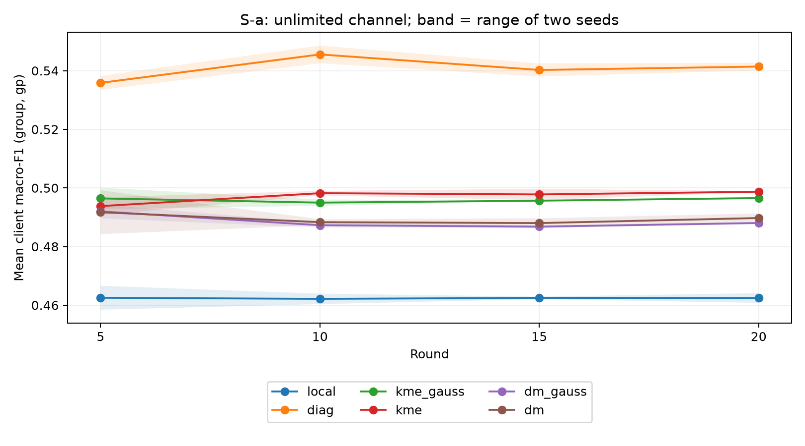
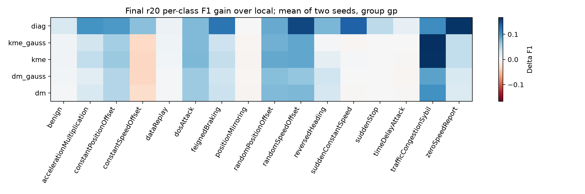
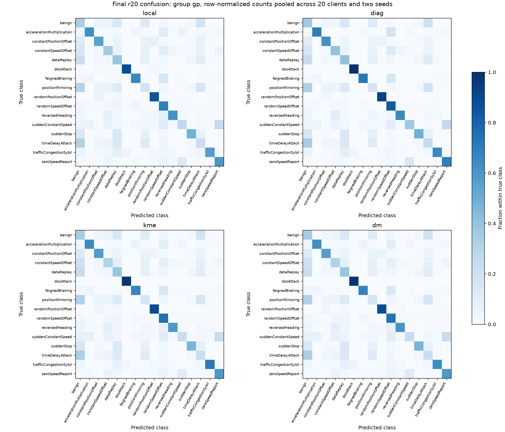

# Pilot S-a — kết quả đã verify

20round,20client,DAGSNet,holdout nội bộ; không giới hạn kênh. Không chứng minh R1.

Train pilot: 1,000,369 dòng; holdout group/old65.536dòng mỗi tập; không official test20%.

Dataset có shortcut Sybil/session, benign từ run Sybil, fingerprint receiver và trần thông tin timeDelay. Nguồn đã loại3.338.358dòng nhập nhằng; partition non-IID là mô phỏng, receiver có thể trải qua nhiều client. Scaler fit toàn train80%, gồm holdout nội bộ: không validation độc lập. R2 mới ở thiết kế; hai seed không chứng minh significance.

| arm | group gp s42/s43 | head s42/s43 | Δlocal s42/s43 | payload lên/xuống mỗi client |
|---|---|---|---|---|
| local | 0.4641 / 0.4608 | 0.4425 / 0.4385 | +0.0000 / +0.0000 | 64 / 64 B |
| diag | 0.5401 / 0.5427 | 0.5021 / 0.5020 | +0.0760 / +0.0819 | 8608 / 4384 B |
| kme_gauss | 0.4970 / 0.4961 | 0.4706 / 0.4687 | +0.0329 / +0.0353 | 16800 / 8480 B |
| kme | 0.4989 / 0.4985 | 0.4727 / 0.4717 | +0.0348 / +0.0377 | 16800 / 8480 B |
| dm_gauss | 0.4884 / 0.4877 | 0.4627 / 0.4612 | +0.0243 / +0.0269 | 8608 / 162400 B |
| dm | 0.4882 / 0.4913 | 0.4622 / 0.4640 | +0.0241 / +0.0305 | 8608 / 162400 B |

Payload một lần gồm object header32B và prior; chưa gồm frame/ACK/retransmission (S-a không kênh).

| arm | old gp s42/s43 | benign group gp s42/s43 | phút/run s42/s43 | applied/skipped s42; s43 |
|---|---|---|---|---|
| local | 0.4602 / 0.4569 | 0.3451 / 0.3407 | 23.6 / 25.0 | 39281/19; 39275/25 |
| diag | 0.5383 / 0.5397 | 0.3647 / 0.3707 | 24.1 / 25.3 | 39233/67; 39243/57 |
| kme_gauss | 0.4888 / 0.4906 | 0.3459 / 0.3515 | 26.1 / 28.5 | 39294/6; 39288/12 |
| kme | 0.4911 / 0.4926 | 0.3468 / 0.3504 | 26.1 / 28.3 | 39292/8; 39283/17 |
| dm_gauss | 0.4838 / 0.4824 | 0.3465 / 0.3476 | 24.1 / 25.1 | 39295/5; 39287/13 |
| dm | 0.4853 / 0.4870 | 0.3445 / 0.3466 | 24.9 / 26.0 | 39294/6; 39284/16 |

Thời gian/run gồm setup, train, evaluate và ghi artifact; các job chia sẻ GPU, không benchmark GPU độc quyền.

## Cổng khóa

- **kme: FAIL**; Δcơ chế [-0.04120177501718908, -0.04421963443566118]; Δbenign [0.0016903542679134187, 0.009710248849646164].
- **dm: FAIL**; Δcơ chế [-0.00019456004880330502, 0.0036055228023418873]; Δbenign [-0.0006547279947735074, 0.005844703820150232].

## Chẩn đoán tối ưu

| arm | seed | synthesis fit đầu → cuối | mean loss train r20 |
|---|---|---|---|
| kme_gauss | 42 | 0.00558881 → 2.34014e-05 | 0.00682498 |
| kme_gauss | 43 | 0.00572444 → 6.91168e-08 | 0.00703317 |
| kme | 42 | 0.01274 → 4.4604e-07 | 0.00699075 |
| kme | 43 | 0.0129335 → 4.23375e-07 | 0.00691531 |
| dm | 42 | 0.268318 → 0.00962393 | 0.00508055 |
| dm | 43 | 0.262047 → 0.00985595 | 0.00490261 |

DM fit là mean20producer; loss giữa KME và DM khác định nghĩa, không so độ lớn trực tiếp. Train loss arm phụ là CE real + CE synthetic, chưa tách từng thành phần. Fit trên mục tiêu đã tối ưu không chứng minh fidelity trên phép đo độc lập hoặc chất lượng phân loại.

KME so diag đổi cả bank hữu hạn và optimizer. DM còn lấy nguồn đều, loại book của chính xe; diag lấy moment quần thể theo số mẫu. Vì vậy chênh lệch với diag không cô lập riêng tác động bank. Đối chứng kme_gauss/dm_gauss mới dùng để chốt lợi của cơ chế thêm vào. Chưa lưu phép đo Fourier độc lập hoặc khoảng cách tới record thật; không suy bảo đảm DP từ provenance noise.

## Đủ10metric, group gp r20

| arm | seed | accuracy | precision_macro | precision_micro | precision_weighted | recall_macro | recall_micro | recall_weighted | f1_macro | f1_micro | f1_weighted |
|---|---|---|---|---|---|---|---|---|---|---|---|
| local | 42 | 0.534380 | 0.551420 | 0.534380 | 0.652764 | 0.521436 | 0.534380 | 0.534380 | 0.464109 | 0.534380 | 0.513093 |
| local | 43 | 0.534446 | 0.547711 | 0.534446 | 0.651590 | 0.519857 | 0.534446 | 0.534446 | 0.460782 | 0.534446 | 0.513061 |
| diag | 42 | 0.590854 | 0.615733 | 0.590854 | 0.686023 | 0.576741 | 0.590854 | 0.590854 | 0.540112 | 0.590854 | 0.578695 |
| diag | 43 | 0.595370 | 0.615017 | 0.595370 | 0.687473 | 0.578836 | 0.595370 | 0.595370 | 0.542718 | 0.595370 | 0.583686 |
| kme_gauss | 42 | 0.582832 | 0.564572 | 0.582832 | 0.669401 | 0.533620 | 0.582832 | 0.582832 | 0.496970 | 0.582832 | 0.572506 |
| kme_gauss | 43 | 0.582943 | 0.567561 | 0.582943 | 0.671186 | 0.534200 | 0.582943 | 0.582943 | 0.496110 | 0.582943 | 0.572572 |
| kme | 42 | 0.582054 | 0.566579 | 0.582054 | 0.669740 | 0.534271 | 0.582054 | 0.582054 | 0.498911 | 0.582054 | 0.572177 |
| kme | 43 | 0.584232 | 0.567096 | 0.584232 | 0.670771 | 0.535614 | 0.584232 | 0.584232 | 0.498498 | 0.584232 | 0.573883 |
| dm_gauss | 42 | 0.562726 | 0.562593 | 0.562726 | 0.661897 | 0.528243 | 0.562726 | 0.562726 | 0.488359 | 0.562726 | 0.548952 |
| dm_gauss | 43 | 0.566441 | 0.562911 | 0.566441 | 0.665239 | 0.530471 | 0.566441 | 0.566441 | 0.487703 | 0.566441 | 0.553233 |
| dm | 42 | 0.565631 | 0.561588 | 0.565631 | 0.664102 | 0.528343 | 0.565631 | 0.565631 | 0.488165 | 0.565631 | 0.553294 |
| dm | 43 | 0.568913 | 0.565016 | 0.568913 | 0.664588 | 0.533167 | 0.568913 | 0.568913 | 0.491308 | 0.568913 | 0.555011 |

## Lớp cần theo dõi, r20 group gp

| class | support/holdout | local s42/s43 | diag s42/s43 | ΔKME−kme_gauss s42/s43 | ΔDM−dm_gauss s42/s43 |
|---|---|---|---|---|---|
| benign | 14812 | 0.3451 / 0.3407 | 0.3647 / 0.3707 | +0.0009 / -0.0011 | -0.0020 / -0.0010 |
| positionMirroring | 2941 | 0.1052 / 0.1076 | 0.1062 / 0.1090 | -0.0005 / +0.0001 | +0.0019 / -0.0033 |
| timeDelayAttack | 3015 | 0.1162 / 0.1161 | 0.1290 / 0.1309 | -0.0053 / -0.0006 | +0.0006 / +0.0021 |
| trafficCongestionSybil | 14371 | 0.6206 / 0.6254 | 0.7207 / 0.7329 | -0.0051 / +0.0021 | +0.0186 / +0.0046 |

## Mọi round đánh giá, đủ10metric

Chỉ đánh giá r5/10/15/20 theo pilot khóa; round khác không có metric đánh giá. 
`accuracy = precision_micro = recall_micro = recall_weighted = f1_micro` cho single-label16class.

| arm | seed | round | holdout | rule | accuracy | precision_macro | precision_micro | precision_weighted | recall_macro | recall_micro | recall_weighted | f1_macro | f1_micro | f1_weighted |
|---|---|---|---|---|---|---|---|---|---|---|---|---|---|---|
| local | 42 | 5 | old | head | 0.510062 | 0.550262 | 0.510062 | 0.652354 | 0.481343 | 0.510062 | 0.510062 | 0.421570 | 0.510062 | 0.489026 |
| local | 42 | 5 | old | gp | 0.542953 | 0.530122 | 0.542953 | 0.646494 | 0.507195 | 0.542953 | 0.542953 | 0.459436 | 0.542953 | 0.533164 |
| local | 42 | 5 | group | head | 0.505451 | 0.550316 | 0.505451 | 0.648201 | 0.481352 | 0.505451 | 0.505451 | 0.420965 | 0.505451 | 0.481179 |
| local | 42 | 5 | group | gp | 0.535530 | 0.527336 | 0.535530 | 0.638465 | 0.506913 | 0.535530 | 0.535530 | 0.458444 | 0.535530 | 0.523432 |
| local | 42 | 10 | old | head | 0.515709 | 0.547810 | 0.515709 | 0.649475 | 0.493743 | 0.515709 | 0.515709 | 0.432678 | 0.515709 | 0.495100 |
| local | 42 | 10 | old | gp | 0.538111 | 0.539973 | 0.538111 | 0.652587 | 0.513421 | 0.538111 | 0.538111 | 0.460596 | 0.538111 | 0.524346 |
| local | 42 | 10 | group | head | 0.516350 | 0.555775 | 0.516350 | 0.652360 | 0.497519 | 0.516350 | 0.516350 | 0.436616 | 0.516350 | 0.492051 |
| local | 42 | 10 | group | gp | 0.537243 | 0.542069 | 0.537243 | 0.646512 | 0.516806 | 0.537243 | 0.537243 | 0.463932 | 0.537243 | 0.519966 |
| local | 42 | 15 | old | head | 0.515601 | 0.554813 | 0.515601 | 0.662356 | 0.498152 | 0.515601 | 0.515601 | 0.435859 | 0.515601 | 0.494642 |
| local | 42 | 15 | old | gp | 0.534792 | 0.545922 | 0.534792 | 0.660048 | 0.515183 | 0.534792 | 0.534792 | 0.458821 | 0.534792 | 0.518517 |
| local | 42 | 15 | group | head | 0.513935 | 0.562192 | 0.513935 | 0.657244 | 0.501498 | 0.513935 | 0.513935 | 0.439228 | 0.513935 | 0.489312 |
| local | 42 | 15 | group | gp | 0.531631 | 0.548722 | 0.531631 | 0.651166 | 0.518845 | 0.531631 | 0.531631 | 0.462077 | 0.531631 | 0.511939 |
| local | 42 | 20 | old | head | 0.518156 | 0.557561 | 0.518156 | 0.664272 | 0.501709 | 0.518156 | 0.518156 | 0.438482 | 0.518156 | 0.495868 |
| local | 42 | 20 | old | gp | 0.536509 | 0.546412 | 0.536509 | 0.657162 | 0.518137 | 0.536509 | 0.536509 | 0.460229 | 0.536509 | 0.518475 |
| local | 42 | 20 | group | head | 0.517313 | 0.563806 | 0.517313 | 0.658657 | 0.505019 | 0.517313 | 0.517313 | 0.442466 | 0.517313 | 0.491447 |
| local | 42 | 20 | group | gp | 0.534380 | 0.551420 | 0.534380 | 0.652764 | 0.521436 | 0.534380 | 0.534380 | 0.464109 | 0.534380 | 0.513093 |
| local | 43 | 5 | old | head | 0.517806 | 0.550191 | 0.517806 | 0.655763 | 0.488220 | 0.517806 | 0.517806 | 0.427092 | 0.517806 | 0.497438 |
| local | 43 | 5 | old | gp | 0.550008 | 0.528056 | 0.550008 | 0.649024 | 0.514978 | 0.550008 | 0.550008 | 0.465310 | 0.550008 | 0.540555 |
| local | 43 | 5 | group | head | 0.514362 | 0.547570 | 0.514362 | 0.650742 | 0.488938 | 0.514362 | 0.514362 | 0.428462 | 0.514362 | 0.490308 |
| local | 43 | 5 | group | gp | 0.544777 | 0.528488 | 0.544777 | 0.641326 | 0.515403 | 0.544777 | 0.544777 | 0.466604 | 0.544777 | 0.532413 |
| local | 43 | 10 | old | head | 0.510529 | 0.547072 | 0.510529 | 0.656689 | 0.493134 | 0.510529 | 0.510529 | 0.428528 | 0.510529 | 0.489328 |
| local | 43 | 10 | old | gp | 0.534132 | 0.534981 | 0.534132 | 0.650993 | 0.513755 | 0.534132 | 0.534132 | 0.457287 | 0.534132 | 0.520195 |
| local | 43 | 10 | group | head | 0.509660 | 0.548006 | 0.509660 | 0.639038 | 0.495092 | 0.509660 | 0.509660 | 0.431919 | 0.509660 | 0.484659 |
| local | 43 | 10 | group | gp | 0.532166 | 0.539567 | 0.532166 | 0.647704 | 0.516105 | 0.532166 | 0.532166 | 0.460364 | 0.532166 | 0.514292 |
| local | 43 | 15 | old | head | 0.517130 | 0.557427 | 0.517130 | 0.661237 | 0.496852 | 0.517130 | 0.517130 | 0.436524 | 0.517130 | 0.495240 |
| local | 43 | 15 | old | gp | 0.536238 | 0.548161 | 0.536238 | 0.658280 | 0.514147 | 0.536238 | 0.536238 | 0.459381 | 0.536238 | 0.518636 |
| local | 43 | 15 | group | head | 0.515892 | 0.563212 | 0.515892 | 0.657846 | 0.499437 | 0.515892 | 0.515892 | 0.439694 | 0.515892 | 0.489970 |
| local | 43 | 15 | group | gp | 0.534323 | 0.551058 | 0.534323 | 0.650357 | 0.517076 | 0.534323 | 0.534323 | 0.462905 | 0.534323 | 0.512863 |
| local | 43 | 20 | old | head | 0.517354 | 0.553178 | 0.517354 | 0.659090 | 0.499601 | 0.517354 | 0.517354 | 0.435011 | 0.517354 | 0.496204 |
| local | 43 | 20 | old | gp | 0.535893 | 0.543914 | 0.535893 | 0.660510 | 0.516568 | 0.535893 | 0.535893 | 0.456946 | 0.535893 | 0.518591 |
| local | 43 | 20 | group | head | 0.516312 | 0.558131 | 0.516312 | 0.654418 | 0.502521 | 0.516312 | 0.516312 | 0.438518 | 0.516312 | 0.491010 |
| local | 43 | 20 | group | gp | 0.534446 | 0.547711 | 0.534446 | 0.651590 | 0.519857 | 0.534446 | 0.534446 | 0.460782 | 0.534446 | 0.513061 |
| diag | 42 | 5 | old | head | 0.561638 | 0.599732 | 0.561638 | 0.691342 | 0.518794 | 0.561638 | 0.561638 | 0.474197 | 0.561638 | 0.540626 |
| diag | 42 | 5 | old | gp | 0.614274 | 0.590070 | 0.614274 | 0.680486 | 0.556050 | 0.614274 | 0.614274 | 0.532406 | 0.614274 | 0.611154 |
| diag | 42 | 5 | group | head | 0.560332 | 0.592095 | 0.560332 | 0.683669 | 0.517883 | 0.560332 | 0.560332 | 0.474524 | 0.560332 | 0.540486 |
| diag | 42 | 5 | group | gp | 0.615825 | 0.587341 | 0.615825 | 0.675357 | 0.555440 | 0.615825 | 0.615825 | 0.533492 | 0.615825 | 0.612453 |
| diag | 42 | 10 | old | head | 0.562255 | 0.618788 | 0.562255 | 0.692824 | 0.539654 | 0.562255 | 0.562255 | 0.495923 | 0.562255 | 0.541726 |
| diag | 42 | 10 | old | gp | 0.596609 | 0.611358 | 0.596609 | 0.685815 | 0.570595 | 0.596609 | 0.596609 | 0.541921 | 0.596609 | 0.591101 |
| diag | 42 | 10 | group | head | 0.561278 | 0.618783 | 0.561278 | 0.692868 | 0.539197 | 0.561278 | 0.561278 | 0.495677 | 0.561278 | 0.540278 |
| diag | 42 | 10 | group | gp | 0.599077 | 0.609326 | 0.599077 | 0.682031 | 0.570575 | 0.599077 | 0.599077 | 0.542549 | 0.599077 | 0.593308 |
| diag | 42 | 15 | old | head | 0.561132 | 0.624720 | 0.561132 | 0.697557 | 0.545893 | 0.561132 | 0.561132 | 0.498559 | 0.561132 | 0.539622 |
| diag | 42 | 15 | old | gp | 0.587984 | 0.612818 | 0.587984 | 0.686798 | 0.573812 | 0.587984 | 0.587984 | 0.537092 | 0.587984 | 0.576867 |
| diag | 42 | 15 | group | head | 0.558804 | 0.621548 | 0.558804 | 0.694795 | 0.546079 | 0.558804 | 0.558804 | 0.498660 | 0.558804 | 0.536317 |
| diag | 42 | 15 | group | gp | 0.589096 | 0.611948 | 0.589096 | 0.684894 | 0.573840 | 0.589096 | 0.589096 | 0.538030 | 0.589096 | 0.578804 |
| diag | 42 | 20 | old | head | 0.562396 | 0.625870 | 0.562396 | 0.698202 | 0.549796 | 0.562396 | 0.562396 | 0.501565 | 0.562396 | 0.539450 |
| diag | 42 | 20 | old | gp | 0.588610 | 0.614321 | 0.588610 | 0.687264 | 0.576066 | 0.588610 | 0.588610 | 0.538288 | 0.588610 | 0.575819 |
| diag | 42 | 20 | group | head | 0.561015 | 0.624537 | 0.561015 | 0.694901 | 0.550025 | 0.561015 | 0.561015 | 0.502055 | 0.561015 | 0.537029 |
| diag | 42 | 20 | group | gp | 0.590854 | 0.615733 | 0.590854 | 0.686023 | 0.576741 | 0.590854 | 0.590854 | 0.540112 | 0.590854 | 0.578695 |
| diag | 43 | 5 | old | head | 0.565311 | 0.598730 | 0.565311 | 0.688725 | 0.520658 | 0.565311 | 0.565311 | 0.478100 | 0.565311 | 0.543151 |
| diag | 43 | 5 | old | gp | 0.619659 | 0.593988 | 0.619659 | 0.680649 | 0.557279 | 0.619659 | 0.619659 | 0.536779 | 0.619659 | 0.615738 |
| diag | 43 | 5 | group | head | 0.567732 | 0.598769 | 0.567732 | 0.683876 | 0.520277 | 0.567732 | 0.567732 | 0.480273 | 0.567732 | 0.546192 |
| diag | 43 | 5 | group | gp | 0.624026 | 0.594736 | 0.624026 | 0.678781 | 0.556717 | 0.624026 | 0.624026 | 0.538215 | 0.624026 | 0.618910 |
| diag | 43 | 10 | old | head | 0.570959 | 0.624925 | 0.570959 | 0.697980 | 0.543310 | 0.570959 | 0.570959 | 0.500081 | 0.570959 | 0.548791 |
| diag | 43 | 10 | old | gp | 0.605252 | 0.609321 | 0.605252 | 0.686245 | 0.574291 | 0.605252 | 0.605252 | 0.545813 | 0.605252 | 0.597430 |
| diag | 43 | 10 | group | head | 0.570461 | 0.619735 | 0.570461 | 0.691868 | 0.544373 | 0.570461 | 0.570461 | 0.501878 | 0.570461 | 0.548263 |
| diag | 43 | 10 | group | gp | 0.608062 | 0.610857 | 0.608062 | 0.683637 | 0.575968 | 0.608062 | 0.608062 | 0.548563 | 0.608062 | 0.600319 |
| diag | 43 | 15 | old | head | 0.564252 | 0.622767 | 0.564252 | 0.697600 | 0.547016 | 0.564252 | 0.564252 | 0.498641 | 0.564252 | 0.540106 |
| diag | 43 | 15 | old | gp | 0.591837 | 0.612205 | 0.591837 | 0.686629 | 0.576212 | 0.591837 | 0.591837 | 0.539126 | 0.591837 | 0.579049 |
| diag | 43 | 15 | group | head | 0.565024 | 0.625059 | 0.565024 | 0.697986 | 0.548156 | 0.565024 | 0.565024 | 0.500451 | 0.565024 | 0.540715 |
| diag | 43 | 15 | group | gp | 0.595951 | 0.615403 | 0.595951 | 0.687846 | 0.577866 | 0.595951 | 0.595951 | 0.542481 | 0.595951 | 0.583979 |
| diag | 43 | 20 | old | head | 0.565036 | 0.622804 | 0.565036 | 0.697088 | 0.549531 | 0.565036 | 0.565036 | 0.500604 | 0.565036 | 0.541576 |
| diag | 43 | 20 | old | gp | 0.591422 | 0.612381 | 0.591422 | 0.686483 | 0.577621 | 0.591422 | 0.591422 | 0.539683 | 0.591422 | 0.578479 |
| diag | 43 | 20 | group | head | 0.565559 | 0.625032 | 0.565559 | 0.697662 | 0.550169 | 0.565559 | 0.565559 | 0.501985 | 0.565559 | 0.541903 |
| diag | 43 | 20 | group | gp | 0.595370 | 0.615017 | 0.595370 | 0.687473 | 0.578836 | 0.595370 | 0.595370 | 0.542718 | 0.595370 | 0.583686 |
| kme_gauss | 42 | 5 | old | head | 0.544427 | 0.554825 | 0.544427 | 0.667407 | 0.488030 | 0.544427 | 0.544427 | 0.443945 | 0.544427 | 0.523799 |
| kme_gauss | 42 | 5 | old | gp | 0.594445 | 0.543144 | 0.594445 | 0.656793 | 0.516578 | 0.594445 | 0.594445 | 0.490016 | 0.594445 | 0.589638 |
| kme_gauss | 42 | 5 | group | head | 0.547540 | 0.556444 | 0.547540 | 0.664569 | 0.489316 | 0.547540 | 0.547540 | 0.446514 | 0.547540 | 0.528327 |
| kme_gauss | 42 | 5 | group | gp | 0.597467 | 0.544066 | 0.597467 | 0.654544 | 0.518925 | 0.597467 | 0.597467 | 0.492776 | 0.597467 | 0.591625 |
| kme_gauss | 42 | 10 | old | head | 0.544526 | 0.562269 | 0.544526 | 0.675471 | 0.501524 | 0.544526 | 0.544526 | 0.454539 | 0.544526 | 0.525380 |
| kme_gauss | 42 | 10 | old | gp | 0.579916 | 0.553083 | 0.579916 | 0.664904 | 0.523817 | 0.579916 | 0.579916 | 0.490068 | 0.579916 | 0.574690 |
| kme_gauss | 42 | 10 | group | head | 0.554046 | 0.564625 | 0.554046 | 0.667965 | 0.506498 | 0.554046 | 0.554046 | 0.461887 | 0.554046 | 0.537871 |
| kme_gauss | 42 | 10 | group | gp | 0.589329 | 0.556487 | 0.589329 | 0.662982 | 0.528816 | 0.589329 | 0.589329 | 0.496063 | 0.589329 | 0.582225 |
| kme_gauss | 42 | 15 | old | head | 0.546735 | 0.560194 | 0.546735 | 0.669767 | 0.508862 | 0.546735 | 0.546735 | 0.460839 | 0.546735 | 0.526777 |
| kme_gauss | 42 | 15 | old | gp | 0.573602 | 0.553796 | 0.573602 | 0.665646 | 0.526889 | 0.573602 | 0.573602 | 0.488097 | 0.573602 | 0.563946 |
| kme_gauss | 42 | 15 | group | head | 0.553411 | 0.565572 | 0.553411 | 0.670482 | 0.512391 | 0.553411 | 0.553411 | 0.467536 | 0.553411 | 0.536547 |
| kme_gauss | 42 | 15 | group | gp | 0.582694 | 0.560267 | 0.582694 | 0.666111 | 0.532170 | 0.582694 | 0.582694 | 0.495716 | 0.582694 | 0.573086 |
| kme_gauss | 42 | 20 | old | head | 0.548688 | 0.562249 | 0.548688 | 0.671964 | 0.510813 | 0.548688 | 0.548688 | 0.463324 | 0.548688 | 0.528925 |
| kme_gauss | 42 | 20 | old | gp | 0.573290 | 0.557458 | 0.573290 | 0.667946 | 0.527895 | 0.573290 | 0.573290 | 0.488812 | 0.573290 | 0.562893 |
| kme_gauss | 42 | 20 | group | head | 0.555547 | 0.569416 | 0.555547 | 0.672884 | 0.515001 | 0.555547 | 0.555547 | 0.470603 | 0.555547 | 0.538509 |
| kme_gauss | 42 | 20 | group | gp | 0.582832 | 0.564572 | 0.582832 | 0.669401 | 0.533620 | 0.582832 | 0.582832 | 0.496970 | 0.582832 | 0.572506 |
| kme_gauss | 43 | 5 | old | head | 0.548769 | 0.563959 | 0.548769 | 0.670266 | 0.494711 | 0.548769 | 0.548769 | 0.454335 | 0.548769 | 0.527552 |
| kme_gauss | 43 | 5 | old | gp | 0.603790 | 0.553280 | 0.603790 | 0.663872 | 0.525642 | 0.603790 | 0.603790 | 0.501294 | 0.603790 | 0.597741 |
| kme_gauss | 43 | 5 | group | head | 0.555663 | 0.566163 | 0.555663 | 0.668361 | 0.495146 | 0.555663 | 0.555663 | 0.456698 | 0.555663 | 0.535809 |
| kme_gauss | 43 | 5 | group | gp | 0.605726 | 0.552098 | 0.605726 | 0.660128 | 0.524692 | 0.605726 | 0.605726 | 0.500067 | 0.605726 | 0.597279 |
| kme_gauss | 43 | 10 | old | head | 0.539870 | 0.564107 | 0.539870 | 0.670512 | 0.502690 | 0.539870 | 0.539870 | 0.453841 | 0.539870 | 0.520829 |
| kme_gauss | 43 | 10 | old | gp | 0.576769 | 0.553948 | 0.576769 | 0.664678 | 0.526052 | 0.576769 | 0.576769 | 0.489749 | 0.576769 | 0.571379 |
| kme_gauss | 43 | 10 | group | head | 0.548696 | 0.566468 | 0.548696 | 0.673801 | 0.505464 | 0.548696 | 0.548696 | 0.458777 | 0.548696 | 0.532723 |
| kme_gauss | 43 | 10 | group | gp | 0.586452 | 0.558362 | 0.586452 | 0.667433 | 0.529203 | 0.586452 | 0.586452 | 0.493911 | 0.586452 | 0.579769 |
| kme_gauss | 43 | 15 | old | head | 0.542589 | 0.568477 | 0.542589 | 0.673783 | 0.507900 | 0.542589 | 0.542589 | 0.461955 | 0.542589 | 0.524450 |
| kme_gauss | 43 | 15 | old | gp | 0.570097 | 0.561376 | 0.570097 | 0.669262 | 0.527481 | 0.570097 | 0.570097 | 0.490062 | 0.570097 | 0.561835 |
| kme_gauss | 43 | 15 | group | head | 0.549689 | 0.572396 | 0.549689 | 0.673993 | 0.511462 | 0.549689 | 0.549689 | 0.467090 | 0.549689 | 0.533104 |
| kme_gauss | 43 | 15 | group | gp | 0.579453 | 0.566869 | 0.579453 | 0.669834 | 0.531682 | 0.579453 | 0.579453 | 0.495579 | 0.579453 | 0.570175 |
| kme_gauss | 43 | 20 | old | head | 0.547790 | 0.569077 | 0.547790 | 0.673494 | 0.511843 | 0.547790 | 0.547790 | 0.464156 | 0.547790 | 0.528563 |
| kme_gauss | 43 | 20 | old | gp | 0.572910 | 0.562641 | 0.572910 | 0.669802 | 0.529904 | 0.572910 | 0.572910 | 0.490623 | 0.572910 | 0.563112 |
| kme_gauss | 43 | 20 | group | head | 0.554492 | 0.572425 | 0.554492 | 0.674541 | 0.514815 | 0.554492 | 0.554492 | 0.468727 | 0.554492 | 0.536889 |
| kme_gauss | 43 | 20 | group | gp | 0.582943 | 0.567561 | 0.582943 | 0.671186 | 0.534200 | 0.582943 | 0.582943 | 0.496110 | 0.582943 | 0.572572 |
| kme | 42 | 5 | old | head | 0.541099 | 0.551361 | 0.541099 | 0.663337 | 0.491557 | 0.541099 | 0.541099 | 0.446027 | 0.541099 | 0.522366 |
| kme | 42 | 5 | old | gp | 0.591737 | 0.539001 | 0.591737 | 0.657622 | 0.519770 | 0.591737 | 0.591737 | 0.488982 | 0.591737 | 0.586475 |
| kme | 42 | 5 | group | head | 0.542095 | 0.553317 | 0.542095 | 0.665863 | 0.491864 | 0.542095 | 0.542095 | 0.447554 | 0.542095 | 0.523963 |
| kme | 42 | 5 | group | gp | 0.591746 | 0.539525 | 0.591746 | 0.654375 | 0.520993 | 0.591746 | 0.591746 | 0.490780 | 0.591746 | 0.585963 |
| kme | 42 | 10 | old | head | 0.542869 | 0.560622 | 0.542869 | 0.670436 | 0.501830 | 0.542869 | 0.542869 | 0.456527 | 0.542869 | 0.524549 |
| kme | 42 | 10 | old | gp | 0.577699 | 0.552038 | 0.577699 | 0.662763 | 0.523974 | 0.577699 | 0.577699 | 0.491022 | 0.577699 | 0.572258 |
| kme | 42 | 10 | group | head | 0.552763 | 0.568090 | 0.552763 | 0.668489 | 0.508130 | 0.552763 | 0.552763 | 0.465898 | 0.552763 | 0.536056 |
| kme | 42 | 10 | group | gp | 0.586903 | 0.559577 | 0.586903 | 0.663109 | 0.530120 | 0.586903 | 0.586903 | 0.498986 | 0.586903 | 0.579633 |
| kme | 42 | 15 | old | head | 0.545869 | 0.565032 | 0.545869 | 0.674171 | 0.507371 | 0.545869 | 0.545869 | 0.460804 | 0.545869 | 0.526607 |
| kme | 42 | 15 | old | gp | 0.572762 | 0.556781 | 0.572762 | 0.667762 | 0.526050 | 0.572762 | 0.572762 | 0.488553 | 0.572762 | 0.563683 |
| kme | 42 | 15 | group | head | 0.551386 | 0.569496 | 0.551386 | 0.670011 | 0.511808 | 0.551386 | 0.551386 | 0.468157 | 0.551386 | 0.533835 |
| kme | 42 | 15 | group | gp | 0.579742 | 0.563022 | 0.579742 | 0.666578 | 0.531206 | 0.579742 | 0.579742 | 0.495892 | 0.579742 | 0.570078 |
| kme | 42 | 20 | old | head | 0.548490 | 0.565896 | 0.548490 | 0.675586 | 0.510779 | 0.548490 | 0.548490 | 0.464805 | 0.548490 | 0.529595 |
| kme | 42 | 20 | old | gp | 0.573917 | 0.559765 | 0.573917 | 0.669829 | 0.528740 | 0.573917 | 0.573917 | 0.491058 | 0.573917 | 0.564468 |
| kme | 42 | 20 | group | head | 0.554874 | 0.571872 | 0.554874 | 0.672622 | 0.515662 | 0.554874 | 0.554874 | 0.472744 | 0.554874 | 0.537868 |
| kme | 42 | 20 | group | gp | 0.582054 | 0.566579 | 0.582054 | 0.669740 | 0.534271 | 0.582054 | 0.582054 | 0.498911 | 0.582054 | 0.572177 |
| kme | 43 | 5 | old | head | 0.540107 | 0.560998 | 0.540107 | 0.667483 | 0.488316 | 0.540107 | 0.540107 | 0.446581 | 0.540107 | 0.518202 |
| kme | 43 | 5 | old | gp | 0.595132 | 0.553063 | 0.595132 | 0.660788 | 0.518371 | 0.595132 | 0.595132 | 0.495977 | 0.595132 | 0.591019 |
| kme | 43 | 5 | group | head | 0.547334 | 0.562619 | 0.547334 | 0.665013 | 0.490116 | 0.547334 | 0.547334 | 0.450945 | 0.547334 | 0.527742 |
| kme | 43 | 5 | group | gp | 0.597794 | 0.554872 | 0.597794 | 0.659276 | 0.519171 | 0.597794 | 0.597794 | 0.496809 | 0.597794 | 0.591766 |
| kme | 43 | 10 | old | head | 0.543794 | 0.565942 | 0.543794 | 0.678313 | 0.503986 | 0.543794 | 0.543794 | 0.458344 | 0.543794 | 0.526061 |
| kme | 43 | 10 | old | gp | 0.579778 | 0.555391 | 0.579778 | 0.664691 | 0.527663 | 0.579778 | 0.579778 | 0.493191 | 0.579778 | 0.574283 |
| kme | 43 | 10 | group | head | 0.548260 | 0.565386 | 0.548260 | 0.666323 | 0.506698 | 0.548260 | 0.548260 | 0.463388 | 0.548260 | 0.532790 |
| kme | 43 | 10 | group | gp | 0.585117 | 0.558938 | 0.585117 | 0.664704 | 0.530897 | 0.585117 | 0.585117 | 0.497427 | 0.585117 | 0.578660 |
| kme | 43 | 15 | old | head | 0.548071 | 0.568093 | 0.548071 | 0.674379 | 0.511308 | 0.548071 | 0.548071 | 0.465669 | 0.548071 | 0.528462 |
| kme | 43 | 15 | old | gp | 0.576108 | 0.562241 | 0.576108 | 0.668761 | 0.530124 | 0.576108 | 0.576108 | 0.493700 | 0.576108 | 0.566959 |
| kme | 43 | 15 | group | head | 0.555334 | 0.571449 | 0.555334 | 0.674371 | 0.514565 | 0.555334 | 0.555334 | 0.471875 | 0.555334 | 0.538121 |
| kme | 43 | 15 | group | gp | 0.584016 | 0.566947 | 0.584016 | 0.670150 | 0.534329 | 0.584016 | 0.584016 | 0.499675 | 0.584016 | 0.574134 |
| kme | 43 | 20 | old | head | 0.549863 | 0.568921 | 0.549863 | 0.674866 | 0.513260 | 0.549863 | 0.549863 | 0.465595 | 0.549863 | 0.530288 |
| kme | 43 | 20 | old | gp | 0.576638 | 0.562980 | 0.576638 | 0.669058 | 0.531689 | 0.576638 | 0.576638 | 0.492637 | 0.576638 | 0.566570 |
| kme | 43 | 20 | group | head | 0.556121 | 0.571682 | 0.556121 | 0.673385 | 0.516611 | 0.556121 | 0.556121 | 0.471722 | 0.556121 | 0.538979 |
| kme | 43 | 20 | group | gp | 0.584232 | 0.567096 | 0.584232 | 0.670771 | 0.535614 | 0.584232 | 0.584232 | 0.498498 | 0.584232 | 0.573883 |
| dm_gauss | 42 | 5 | old | head | 0.533814 | 0.564006 | 0.533814 | 0.674200 | 0.485198 | 0.533814 | 0.533814 | 0.443062 | 0.533814 | 0.517942 |
| dm_gauss | 42 | 5 | old | gp | 0.583526 | 0.551655 | 0.583526 | 0.663342 | 0.514369 | 0.583526 | 0.583526 | 0.487794 | 0.583526 | 0.581755 |
| dm_gauss | 42 | 5 | group | head | 0.531192 | 0.566754 | 0.531192 | 0.669537 | 0.486769 | 0.531192 | 0.531192 | 0.445070 | 0.531192 | 0.514449 |
| dm_gauss | 42 | 5 | group | gp | 0.578214 | 0.554773 | 0.578214 | 0.659291 | 0.515934 | 0.578214 | 0.578214 | 0.489626 | 0.578214 | 0.575653 |
| dm_gauss | 42 | 10 | old | head | 0.537389 | 0.560869 | 0.537389 | 0.664414 | 0.497153 | 0.537389 | 0.537389 | 0.450729 | 0.537389 | 0.517952 |
| dm_gauss | 42 | 10 | old | gp | 0.567907 | 0.549979 | 0.567907 | 0.657160 | 0.517658 | 0.567907 | 0.567907 | 0.481423 | 0.567907 | 0.558641 |
| dm_gauss | 42 | 10 | group | head | 0.536839 | 0.564373 | 0.536839 | 0.658931 | 0.500601 | 0.536839 | 0.536839 | 0.455190 | 0.536839 | 0.514767 |
| dm_gauss | 42 | 10 | group | gp | 0.567018 | 0.556473 | 0.567018 | 0.654369 | 0.521744 | 0.567018 | 0.567018 | 0.486463 | 0.567018 | 0.555203 |
| dm_gauss | 42 | 15 | old | head | 0.539156 | 0.563585 | 0.539156 | 0.670308 | 0.504301 | 0.539156 | 0.539156 | 0.457123 | 0.539156 | 0.520550 |
| dm_gauss | 42 | 15 | old | gp | 0.563477 | 0.553995 | 0.563477 | 0.662280 | 0.521983 | 0.563477 | 0.563477 | 0.482600 | 0.563477 | 0.553382 |
| dm_gauss | 42 | 15 | group | head | 0.536977 | 0.566429 | 0.536977 | 0.663638 | 0.507468 | 0.536977 | 0.536977 | 0.460449 | 0.536977 | 0.515213 |
| dm_gauss | 42 | 15 | group | gp | 0.561954 | 0.558752 | 0.561954 | 0.658598 | 0.526357 | 0.561954 | 0.561954 | 0.487206 | 0.561954 | 0.549647 |
| dm_gauss | 42 | 20 | old | head | 0.541119 | 0.566443 | 0.541119 | 0.672639 | 0.506666 | 0.541119 | 0.541119 | 0.458976 | 0.541119 | 0.521647 |
| dm_gauss | 42 | 20 | old | gp | 0.564383 | 0.558599 | 0.564383 | 0.666157 | 0.524327 | 0.564383 | 0.564383 | 0.483762 | 0.564383 | 0.552712 |
| dm_gauss | 42 | 20 | group | head | 0.539006 | 0.568597 | 0.539006 | 0.667196 | 0.510104 | 0.539006 | 0.539006 | 0.462743 | 0.539006 | 0.516571 |
| dm_gauss | 42 | 20 | group | gp | 0.562726 | 0.562593 | 0.562726 | 0.661897 | 0.528243 | 0.562726 | 0.562726 | 0.488359 | 0.562726 | 0.548952 |
| dm_gauss | 43 | 5 | old | head | 0.540530 | 0.561924 | 0.540530 | 0.671787 | 0.492516 | 0.540530 | 0.540530 | 0.443909 | 0.540530 | 0.519296 |
| dm_gauss | 43 | 5 | old | gp | 0.591995 | 0.546009 | 0.591995 | 0.659278 | 0.523490 | 0.591995 | 0.591995 | 0.491795 | 0.591995 | 0.586416 |
| dm_gauss | 43 | 5 | group | head | 0.540837 | 0.565900 | 0.540837 | 0.665812 | 0.494558 | 0.540837 | 0.540837 | 0.447344 | 0.540837 | 0.518399 |
| dm_gauss | 43 | 5 | group | gp | 0.591344 | 0.549585 | 0.591344 | 0.655558 | 0.525416 | 0.591344 | 0.591344 | 0.494363 | 0.591344 | 0.583484 |
| dm_gauss | 43 | 10 | old | head | 0.534835 | 0.560103 | 0.534835 | 0.670831 | 0.499512 | 0.534835 | 0.534835 | 0.449257 | 0.534835 | 0.515944 |
| dm_gauss | 43 | 10 | old | gp | 0.568900 | 0.551089 | 0.568900 | 0.665405 | 0.522892 | 0.568900 | 0.568900 | 0.482809 | 0.568900 | 0.561290 |
| dm_gauss | 43 | 10 | group | head | 0.535531 | 0.568654 | 0.535531 | 0.670488 | 0.503427 | 0.535531 | 0.535531 | 0.453963 | 0.535531 | 0.513872 |
| dm_gauss | 43 | 10 | group | gp | 0.570234 | 0.557557 | 0.570234 | 0.663078 | 0.527024 | 0.570234 | 0.570234 | 0.488084 | 0.570234 | 0.560587 |
| dm_gauss | 43 | 15 | old | head | 0.533739 | 0.564823 | 0.533739 | 0.674923 | 0.503548 | 0.533739 | 0.533739 | 0.453787 | 0.533739 | 0.515636 |
| dm_gauss | 43 | 15 | old | gp | 0.559431 | 0.555452 | 0.559431 | 0.667060 | 0.523191 | 0.559431 | 0.559431 | 0.480828 | 0.559431 | 0.549853 |
| dm_gauss | 43 | 15 | group | head | 0.535309 | 0.568288 | 0.535309 | 0.669539 | 0.506486 | 0.535309 | 0.535309 | 0.457805 | 0.535309 | 0.514229 |
| dm_gauss | 43 | 15 | group | gp | 0.562531 | 0.560777 | 0.562531 | 0.664118 | 0.526958 | 0.562531 | 0.562531 | 0.486367 | 0.562531 | 0.550986 |
| dm_gauss | 43 | 20 | old | head | 0.539404 | 0.565021 | 0.539404 | 0.674440 | 0.508044 | 0.539404 | 0.539404 | 0.456520 | 0.539404 | 0.520439 |
| dm_gauss | 43 | 20 | old | gp | 0.563902 | 0.557263 | 0.563902 | 0.668484 | 0.526433 | 0.563902 | 0.563902 | 0.482372 | 0.563902 | 0.553037 |
| dm_gauss | 43 | 20 | group | head | 0.540991 | 0.570866 | 0.540991 | 0.670622 | 0.511635 | 0.540991 | 0.540991 | 0.461195 | 0.540991 | 0.518948 |
| dm_gauss | 43 | 20 | group | gp | 0.566441 | 0.562911 | 0.566441 | 0.665239 | 0.530471 | 0.566441 | 0.566441 | 0.487703 | 0.566441 | 0.553233 |
| dm | 42 | 5 | old | head | 0.531552 | 0.558018 | 0.531552 | 0.668140 | 0.483064 | 0.531552 | 0.531552 | 0.438119 | 0.531552 | 0.513517 |
| dm | 42 | 5 | old | gp | 0.582020 | 0.545838 | 0.582020 | 0.660361 | 0.513488 | 0.582020 | 0.582020 | 0.484505 | 0.582020 | 0.580357 |
| dm | 42 | 5 | group | head | 0.527763 | 0.559929 | 0.527763 | 0.666758 | 0.483540 | 0.527763 | 0.527763 | 0.438482 | 0.527763 | 0.507964 |
| dm | 42 | 5 | group | gp | 0.576254 | 0.545498 | 0.576254 | 0.654327 | 0.513806 | 0.576254 | 0.576254 | 0.484238 | 0.576254 | 0.573009 |
| dm | 42 | 10 | old | head | 0.539654 | 0.555176 | 0.539654 | 0.666547 | 0.504412 | 0.539654 | 0.539654 | 0.454658 | 0.539654 | 0.521161 |
| dm | 42 | 10 | old | gp | 0.569933 | 0.544986 | 0.569933 | 0.656952 | 0.525273 | 0.569933 | 0.569933 | 0.486221 | 0.569933 | 0.563173 |
| dm | 42 | 10 | group | head | 0.537569 | 0.557021 | 0.537569 | 0.660534 | 0.505294 | 0.537569 | 0.537569 | 0.456608 | 0.537569 | 0.518481 |
| dm | 42 | 10 | group | gp | 0.569866 | 0.549165 | 0.569866 | 0.655991 | 0.527593 | 0.569866 | 0.569866 | 0.489329 | 0.569866 | 0.562072 |
| dm | 42 | 15 | old | head | 0.540572 | 0.563667 | 0.540572 | 0.668602 | 0.505442 | 0.540572 | 0.540572 | 0.457136 | 0.540572 | 0.521718 |
| dm | 42 | 15 | old | gp | 0.565708 | 0.557930 | 0.565708 | 0.665465 | 0.524108 | 0.565708 | 0.565708 | 0.483943 | 0.565708 | 0.555621 |
| dm | 42 | 15 | group | head | 0.537543 | 0.566050 | 0.537543 | 0.666543 | 0.506171 | 0.537543 | 0.537543 | 0.458306 | 0.537543 | 0.517045 |
| dm | 42 | 15 | group | gp | 0.564246 | 0.560075 | 0.564246 | 0.662076 | 0.526042 | 0.564246 | 0.564246 | 0.486371 | 0.564246 | 0.552830 |
| dm | 42 | 20 | old | head | 0.543498 | 0.563974 | 0.543498 | 0.670277 | 0.509057 | 0.543498 | 0.543498 | 0.460323 | 0.543498 | 0.524128 |
| dm | 42 | 20 | old | gp | 0.566586 | 0.558686 | 0.566586 | 0.666577 | 0.526430 | 0.566586 | 0.566586 | 0.485284 | 0.566586 | 0.555279 |
| dm | 42 | 20 | group | head | 0.540809 | 0.567754 | 0.540809 | 0.669622 | 0.509930 | 0.540809 | 0.540809 | 0.462188 | 0.540809 | 0.519996 |
| dm | 42 | 20 | group | gp | 0.565631 | 0.561588 | 0.565631 | 0.664102 | 0.528343 | 0.565631 | 0.565631 | 0.488165 | 0.565631 | 0.553294 |
| dm | 43 | 5 | old | head | 0.537710 | 0.567244 | 0.537710 | 0.675898 | 0.489536 | 0.537710 | 0.537710 | 0.447957 | 0.537710 | 0.520735 |
| dm | 43 | 5 | old | gp | 0.594279 | 0.557283 | 0.594279 | 0.665358 | 0.522392 | 0.594279 | 0.594279 | 0.497048 | 0.594279 | 0.591472 |
| dm | 43 | 5 | group | head | 0.537404 | 0.569260 | 0.537404 | 0.667683 | 0.491949 | 0.537404 | 0.537404 | 0.450708 | 0.537404 | 0.519094 |
| dm | 43 | 5 | group | gp | 0.592579 | 0.561347 | 0.592579 | 0.662721 | 0.524584 | 0.592579 | 0.592579 | 0.499190 | 0.592579 | 0.587838 |
| dm | 43 | 10 | old | head | 0.533900 | 0.558529 | 0.533900 | 0.667386 | 0.499536 | 0.533900 | 0.533900 | 0.449309 | 0.533900 | 0.513327 |
| dm | 43 | 10 | old | gp | 0.566742 | 0.549968 | 0.566742 | 0.663561 | 0.523392 | 0.566742 | 0.566742 | 0.483481 | 0.566742 | 0.558545 |
| dm | 43 | 10 | group | head | 0.532847 | 0.563243 | 0.532847 | 0.662963 | 0.502018 | 0.532847 | 0.532847 | 0.452432 | 0.532847 | 0.509823 |
| dm | 43 | 10 | group | gp | 0.567098 | 0.555762 | 0.567098 | 0.660117 | 0.526349 | 0.567098 | 0.567098 | 0.487314 | 0.567098 | 0.556242 |
| dm | 43 | 15 | old | head | 0.541206 | 0.563030 | 0.541206 | 0.669645 | 0.507184 | 0.541206 | 0.541206 | 0.456574 | 0.541206 | 0.521060 |
| dm | 43 | 15 | old | gp | 0.568298 | 0.557346 | 0.568298 | 0.666144 | 0.527182 | 0.568298 | 0.568298 | 0.484829 | 0.568298 | 0.557298 |
| dm | 43 | 15 | group | head | 0.540683 | 0.570072 | 0.540683 | 0.666697 | 0.511071 | 0.540683 | 0.540683 | 0.461195 | 0.540683 | 0.517178 |
| dm | 43 | 15 | group | gp | 0.568535 | 0.563228 | 0.568535 | 0.662252 | 0.531159 | 0.568535 | 0.568535 | 0.489640 | 0.568535 | 0.554257 |
| dm | 43 | 20 | old | head | 0.543985 | 0.563612 | 0.543985 | 0.670442 | 0.510302 | 0.543985 | 0.543985 | 0.459757 | 0.543985 | 0.524077 |
| dm | 43 | 20 | old | gp | 0.569256 | 0.560571 | 0.569256 | 0.668823 | 0.529445 | 0.569256 | 0.569256 | 0.487037 | 0.569256 | 0.558186 |
| dm | 43 | 20 | group | head | 0.542727 | 0.569654 | 0.542727 | 0.666467 | 0.514048 | 0.542727 | 0.542727 | 0.464047 | 0.542727 | 0.519840 |
| dm | 43 | 20 | group | gp | 0.568913 | 0.565016 | 0.568913 | 0.664588 | 0.533167 | 0.568913 | 0.568913 | 0.491308 | 0.568913 | 0.555011 |

## Đường học và từng lớp

Dải là min/max hai seed, không phải confidence interval. F1 là mean20private, không metric từ confusion gộp.

Delta so local cùng seed, r20 cố định; không chọn checkpoint tốt nhất. Support mỗi lớp trong [per-class-final.csv](per-class-final.csv).

Confusion cộng counts40private, chuẩn hóa theo true class; chỉ minh họa lỗi. Macro-F1 headline vẫn là mean metric từng private, không tính từ confusion gộp.

Thiết lập/cài đặt/nguồn/attempt: [rebuild.md](rebuild.md). Weights, predictions và confusion từng client nằm trong [runs/](runs/). Hardware/source từng kernel đã kiểm qua output `source/`, log2×T4 và executed notebook v1.

Verifier strict-load/kiểm finite weights, rồi tính lại metric từ predictions lưu; chưa tái-inference toàn bộ holdout từ weights. Điểm đo tổng quát hóa trên holdout chung, không đo phân bố local riêng của từng client.
