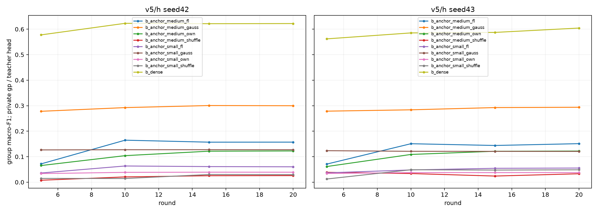
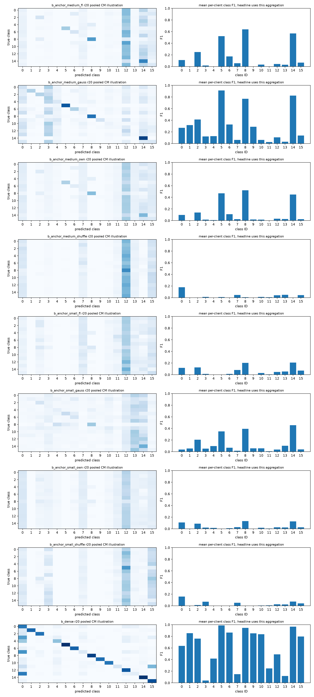
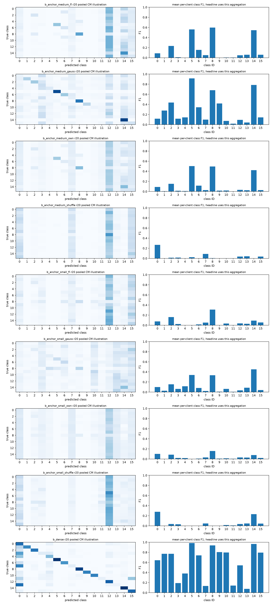

# Figures from terminal audited artifacts

Pooled confusion is illustration; headline/per-class F1 are mean per-client metrics. Partial checkpoints retain round labels.

[SVG export](convergence-h.svg)

[SVG export](classes-h-s42.svg)

[SVG export](classes-h-s43.svg)

